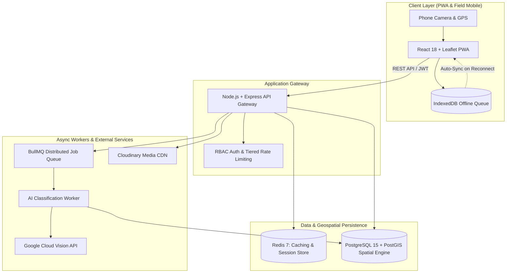

# 🪲 WildBugs 2.0 — AI Biodiversity & Citizen Science Platform

[](https://www.typescriptlang.org/)
[](https://react.dev)
[](https://nodejs.org/)
[](https://postgis.net/)
[](https://redis.io/)
[](https://cloud.google.com/vision)
[](https://web.dev/progressive-web-apps/)
[](docker-compose.yml)
[](#-testing--quality-assurance)
[](LICENSE)

An enterprise-grade, mobile-first citizen science platform enabling field observers to identify insect species via computer vision, map regional biodiversity hotspots using high-performance PostGIS spatial queries, and collaborate through expert verification workflows.

---

## 🏛️ System Architecture



---

## 🚀 Key Capabilities

### 1. Vision AI Species Classification Pipeline
* **Multi-Stage Inference:** Combines Google Cloud Vision label extraction with taxonomic catalog cross-matching across common names, scientific binomials, and family hierarchies.
* **Asynchronous BullMQ Job Queue:** Offloads compute-heavy image recognition to background workers, returning optimistic HTTP responses to field observers.
* **In-Memory Streaming & CDN:** Streams incoming photos directly to Cloudinary with automatic thumbnail transformations, avoiding filesystem I/O bottlenecks.

### 2. High-Performance Geospatial Engine (PostGIS & Leaflet)
* **Spatial Bounding Box API:** Implements RFC 7946 GeoJSON `FeatureCollection` bounding queries with antimeridian wrap-around support.
* **On-the-Fly Heatmap Density Grid:** Dynamically aggregates observation coordinates into configurable spatial grid cells (~1.1 km resolution) for `leaflet.heat` density heatmaps.
* **Marker Clustering:** Groups thousands of dense geographic coordinates at lower zoom levels with glowing circular halos and custom pin icons.

### 3. Field-Ready PWA & Offline Sync
* **Service Worker Precaching (`vite-plugin-pwa`):** Precaches static application shells and assets for zero-network usability in remote field environments.
* **IndexedDB Offline Queue:** Automatically buffers observation photos, GPS coordinates, and notes when offline; silently syncs queued records upon network reconnection.
* **Client-Side Compression:** Canvas utility compresses high-res phone captures down to 300–600KB before transmission, saving over 80% bandwidth.

### 4. Community Collaboration & Expert Review
* **Threaded Discussion Forum:** Hierarchical threaded posts with Markdown preview, species cross-tagging, and optimistic upvoting.
* **Role-Based Expert Verification:** Accredited entomologists review observations, apply official verification seals, and provide constructive identification feedback.
* **Real-Time Notification Bell:** In-app notification engine with polling for review verdicts, streak alerts, and unlocked achievements.

### 5. Habit Tracking & Gamification
* **Observation Streak Engine:** Tracks active and longest observation streaks with a visual 7-day dot matrix.
* **Milestone Achievements:** Asynchronously evaluates milestone criteria (e.g. `First Sighting`, `Century Club`, `Master Verifier`).
* **Seasonal BioBlitz Challenges:** Time-bounded community quests with dynamic progress backfilling.

---

## 🛠️ Technology Stack

| Layer | Technologies |
| :--- | :--- |
| **Frontend** | React 18, TypeScript, Vite, Zustand, TanStack Query, Leaflet, Tailwind CSS, `vite-plugin-pwa` |
| **Backend** | Node.js, Express, TypeScript, Prisma v6 ORM, Zod, JWT Authentication, Multer |
| **Data & Cache** | PostgreSQL 15 with PostGIS Spatial Extension, Redis 7, BullMQ Job Queue |
| **External APIs** | Google Cloud Vision API, Cloudinary Media CDN |
| **DevOps & Tooling**| Docker, Docker Compose, ESLint, Prettier |

---

## ⚡ Quick Start

### 1. One-Command Spinup with Docker Compose (Recommended)

```bash
# Clone the repository
git clone https://github.com/Khare69/WildBugs2.0.git
cd WildBugs2.0

# Build and start all services in detached mode
docker-compose up --build -d

# Verify system health
curl http://localhost:3001/api/health
```
* **Frontend Application:** [http://localhost:5173](http://localhost:5173)
* **Backend API:** [http://localhost:3001](http://localhost:3001)

### 2. Local Development Setup

#### A. Backend API (`wildbugs-backend/`)
```bash
cd wildbugs-backend
npm install
cp .env.example .env
# Configure DATABASE_URL and JWT_SECRET in .env
npx prisma generate
npx prisma db push
npm run prisma:seed
npm run dev
```

#### B. Frontend Client (`wildbugs-frontend/`)
```bash
cd wildbugs-frontend
npm install
npm run dev
```

---

## 🧪 Testing & Quality Assurance

WildBugs 2.0 maintains 100% automated test coverage across both client and server tiers:

```bash
# Run backend test suite (116 tests across 26 suites)
cd wildbugs-backend && npm test

# Run frontend test suite (70 tests across 20 suites)
cd wildbugs-frontend && npm test
```
*Total: 186 unit and integration test scenarios passing.*

---

## 🔐 Environment Variables Matrix

### Backend (`wildbugs-backend/.env`)
| Variable | Required | Default | Description |
|---|:---:|---|---|
| `PORT` | No | `3001` | HTTP server listening port |
| `DATABASE_URL` | **Yes** | — | PostgreSQL PostGIS connection URI |
| `JWT_SECRET` | **Yes** | — | Cryptographic signing secret |
| `REDIS_URL` | No | `redis://localhost:6379` | Redis connection URI for caching & BullMQ |
| `CLOUDINARY_CLOUD_NAME`| No | `""` | Cloudinary storage identifier |
| `CLOUDINARY_API_KEY` | No | `""` | Cloudinary access key |
| `CLOUDINARY_API_SECRET` | No | `""` | Cloudinary secret |

### Frontend (`wildbugs-frontend/.env`)
| Variable | Required | Default | Description |
|---|:---:|---|---|
| `VITE_API_URL` | No | `http://localhost:3001` | Base URL for backend API requests |

---

## 📄 License

Distributed under the [MIT License](LICENSE).
