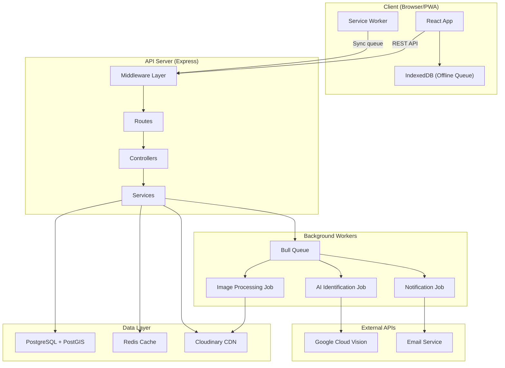
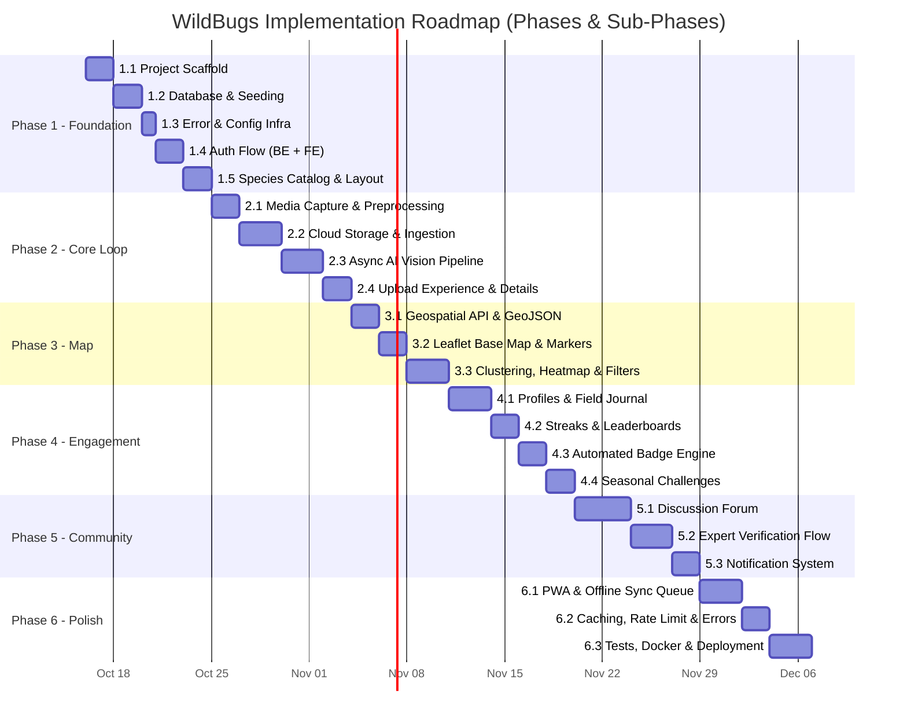
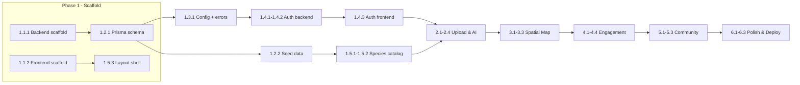

# 🪲 WildBugs — Architecture & Implementation Plan

---

## 1. Requirements Analysis

### ✅ What the Problem Statement Gives Us

| Area | Requirements |
|---|---|
| **Insect ID** | Photo upload/capture → AI identification → species info → expert corrections |
| **Biodiversity Map** | Interactive map, heatmap, filters (species/time/region), marker clustering |
| **User Profiles** | Field journal, badges, streaks, seasonal challenges, stats |
| **Community** | Forums, expert verification, photo ratings, leaderboards |
| **Challenges** | Time-limited, team-based, progress tracking, rewards |
| **Scale** | ~5,000 users, ~50 uploads/day, ~200 species, 1 region |
| **Constraints** | Mobile-first, 10MB images, <2s API, offline capture, 95% uptime |

### 🚨 Missing Requirements (Gaps I've Identified)

These are things the problem statement **doesn't mention** but you'll absolutely need:

| # | Gap | Why It Matters | My Recommendation |
|---|---|---|---|
| 1 | **No auth strategy specified** | Who can upload? Who are "experts"? | Email/password + Google OAuth. Experts = manually promoted by admin. |
| 2 | **No admin panel mentioned** | Who manages species DB, bans users, verifies experts? | Build a basic admin dashboard (user management, species CRUD, flagged content). |
| 3 | **No moderation system** | Users will upload inappropriate/wrong images | Auto-flag via AI (NSFW detection) + community reporting + admin review queue. |
| 4 | **No notification system** | How do users know their ID was verified or a challenge ended? | In-app notifications + optional email digests. |
| 5 | **"Offline capture with later sync" is vague** | How much works offline? Just camera or also browsing? | PWA with offline camera capture + local queue. Browsing requires network. |
| 6 | **No data privacy / GDPR plan** | Location data is sensitive | GPS coordinates stored, but exact location hidden from other users (snap to ~1km grid). Users can delete all their data. |
| 7 | **No image processing pipeline** | Raw 10MB photos will kill performance | Compress on upload → store original + thumbnail + medium size. |
| 8 | **No rate limiting / abuse prevention** | Bots could spam uploads | Rate limit: 20 uploads/hour/user, 100 API calls/min/user. |
| 9 | **No error handling strategy** | What happens when AI identification fails? | Graceful fallback: show "Could not identify — submit for community ID" |
| 10 | **No backup / disaster recovery** | 95% uptime but no plan if DB crashes | Daily automated DB backups, 7-day retention. |

---

## 2. Technology Stack (The "Why" in Plain English)

### The Stack at a Glance

```
┌─────────────────────────────────────────────────────┐
│                    FRONTEND                         │
│   React 18 + Vite + TypeScript                      │
│   Zustand (state) · TanStack Query (API) · Leaflet  │
│   PWA (vite-plugin-pwa)                             │
└──────────────────────┬──────────────────────────────┘
                       │  REST API (JSON)
┌──────────────────────▼──────────────────────────────┐
│                    BACKEND                          │
│   Node.js + Express + TypeScript                    │
│   Prisma ORM · JWT Auth · Multer (uploads)          │
│   Redis (caching) · Bull (job queues)               │
└──────────────────────┬──────────────────────────────┘
                       │
        ┌──────────────┼──────────────┐
        ▼              ▼              ▼
  ┌──────────┐  ┌───────────┐  ┌───────────┐
  │PostgreSQL│  │ Cloudinary│  │ Google     │
  │ + PostGIS│  │  (images) │  │ Cloud      │
  │          │  │           │  │ Vision API │
  └──────────┘  └───────────┘  └───────────┘
```

### Why Each Technology?

#### Frontend

| Tech | What It Does | Why This Over Alternatives |
|---|---|---|
| **React 18** | Builds the UI as reusable components | Largest ecosystem, most tutorials, most job-relevant. Vue/Svelte are great but have fewer resources for beginners. |
| **Vite** | Dev server + build tool | 10x faster than Create React App. Hot reload in milliseconds. Next.js adds SSR complexity you don't need — your SEO pages (species info) can use pre-rendered static pages with Vite. |
| **TypeScript** | Adds types to JavaScript | Catches bugs before they run. Like spell-check for code. Non-negotiable for a project this size. |
| **Zustand** | Global state management | 3 files to learn vs Redux's 30. Stores things like "logged in user" and "current map filters". |
| **TanStack Query** | Fetches & caches API data | Automatically retries failed requests, caches results, shows loading/error states. Handles 80% of the "API complexity" for you. |
| **Leaflet** | Interactive maps | Free & open-source (Google Maps costs money at scale). Has heatmap & clustering plugins. |
| **vite-plugin-pwa** | Makes app installable + offline | One config file gives you the offline camera capture requirement. |

#### Backend

| Tech | What It Does | Why This Over Alternatives |
|---|---|---|
| **Node.js + Express** | HTTP server that handles API requests | Same language (JS/TS) as frontend — you learn one language, not two. Express is minimal and unopinionated, so you understand every line. Django/Rails hide too much magic from beginners. |
| **Prisma ORM** | Talks to the database in TypeScript | Write `prisma.user.findMany()` instead of raw SQL. Auto-generates types. Migrations are one command. |
| **PostgreSQL + PostGIS** | Database + geospatial extension | PostGIS is **the** reason to pick Postgres here. Your biodiversity map needs queries like "find all sightings within 50km of Delhi" — PostGIS does this natively and fast. MySQL/MongoDB cannot compete on geospatial. |
| **Redis** | In-memory cache | Stores frequently-accessed data (leaderboards, species list) in RAM. Makes your <2s API response target trivially achievable. |
| **Bull** | Background job queue | AI identification takes 3-5 seconds. Don't make the user wait — queue the job, return immediately, notify when done. |
| **JWT** | Authentication tokens | User logs in → gets a token → sends it with every request. Stateless, simple, works great with mobile. |
| **Multer** | Handles file uploads | Parses multipart form data (photos) from HTTP requests. Industry standard for Node.js. |
| **Cloudinary** | Image storage + processing | Free tier: 25GB storage + 25GB bandwidth/month. Auto-generates thumbnails, compresses images, serves via CDN. You'd spend weeks building this yourself. |
| **Google Cloud Vision API** | AI insect identification | Pre-trained image recognition. Free tier: 1,000 images/month. Combine with a custom label set for your 200 species. |

---

## 3. Architecture Design

### 3.1 System Architecture



### 3.2 Database Schema (Core Tables)

```mermaid
erDiagram
    users {
        uuid id PK
        string email UK
        string password_hash
        string display_name
        string avatar_url
        enum role "user | expert | admin"
        jsonb stats
        timestamp created_at
    }

    species {
        int id PK
        string common_name
        string scientific_name
        string family
        text description
        text habitat
        text diet
        text lifecycle
        string image_url
        string conservation_status
    }

    sightings {
        uuid id PK
        uuid user_id FK
        int species_id FK "nullable until identified"
        string photo_url
        string thumbnail_url
        float latitude
        float longitude
        geography point "PostGIS geometry"
        float ai_confidence
        enum status "pending | identified | verified | rejected"
        timestamp observed_at
        timestamp created_at
    }

    identifications {
        uuid id PK
        uuid sighting_id FK
        uuid user_id FK
        int species_id FK
        enum source "ai | user | expert"
        float confidence
        boolean is_accepted
        timestamp created_at
    }

    badges {
        int id PK
        string name
        string description
        string icon_url
        jsonb criteria
    }

    user_badges {
        uuid user_id FK
        int badge_id FK
        timestamp earned_at
    }

    challenges {
        int id PK
        string title
        text description
        jsonb criteria
        timestamp starts_at
        timestamp ends_at
        enum scope "individual | team"
    }

    challenge_progress {
        uuid id PK
        int challenge_id FK
        uuid user_id FK
        int progress
        boolean completed
    }

    forum_posts {
        uuid id PK
        uuid author_id FK
        uuid parent_id FK "nullable, for replies"
        int species_id FK "nullable"
        string title
        text body
        int upvotes
        timestamp created_at
    }

    notifications {
        uuid id PK
        uuid user_id FK
        string type
        string message
        jsonb data
        boolean read
        timestamp created_at
    }

    users ||--o{ sightings : "uploads"
    users ||--o{ identifications : "identifies"
    users ||--o{ user_badges : "earns"
    users ||--o{ challenge_progress : "participates"
    users ||--o{ forum_posts : "writes"
    users ||--o{ notifications : "receives"
    species ||--o{ sightings : "seen at"
    species ||--o{ identifications : "classified as"
    sightings ||--o{ identifications : "has"
    badges ||--o{ user_badges : "awarded"
    challenges ||--o{ challenge_progress : "tracked by"
```



### 3.3 API Design (Core Endpoints)

| Method | Endpoint | Purpose | Auth |
|---|---|---|---|
| `POST` | `/api/auth/register` | Create account | ❌ |
| `POST` | `/api/auth/login` | Get JWT token | ❌ |
| `POST` | `/api/auth/google` | OAuth login | ❌ |
| `GET` | `/api/users/me` | Get profile | ✅ |
| `PUT` | `/api/users/me` | Update profile | ✅ |
| `GET` | `/api/users/:id/journal` | Public field journal | ❌ |
| `GET` | `/api/users/leaderboard` | Regional leaderboard | ❌ |
| `POST` | `/api/sightings` | Upload photo + location | ✅ |
| `GET` | `/api/sightings` | List (with geo/species/date filters) | ❌ |
| `GET` | `/api/sightings/:id` | Sighting detail | ❌ |
| `POST` | `/api/sightings/:id/identify` | Submit identification | ✅ |
| `POST` | `/api/sightings/:id/verify` | Expert verification | ✅ Expert |
| `GET` | `/api/species` | List all species | ❌ |
| `GET` | `/api/species/:id` | Species detail | ❌ |
| `GET` | `/api/map/sightings` | GeoJSON for map layer | ❌ |
| `GET` | `/api/map/heatmap` | Heatmap density data | ❌ |
| `GET` | `/api/challenges` | Active challenges | ✅ |
| `GET` | `/api/challenges/:id/progress` | My progress | ✅ |
| `GET/POST` | `/api/forum/posts` | List/Create posts | ✅ for POST |
| `GET` | `/api/notifications` | My notifications | ✅ |
| `GET` | `/api/badges` | All available badges | ❌ |

---

## 4. Full Project Structure

### Frontend

```
wildbugs-frontend/
├── public/
│   ├── manifest.json              # PWA manifest
│   ├── sw.js                      # Service worker (auto-generated)
│   └── icons/                     # App icons (192x192, 512x512)
│
├── src/
│   ├── main.tsx                   # App entry point
│   ├── App.tsx                    # Root component + router setup
│   ├── vite-env.d.ts              # Vite type declarations
│   │
│   ├── pages/                     # One file per route
│   │   ├── HomePage.tsx           # Landing page + recent sightings
│   │   ├── LoginPage.tsx          # Login form
│   │   ├── RegisterPage.tsx       # Registration form
│   │   ├── UploadPage.tsx         # Camera capture + photo upload
│   │   ├── SightingDetailPage.tsx # Single sighting with ID results
│   │   ├── MapPage.tsx            # Full-screen biodiversity map
│   │   ├── SpeciesListPage.tsx    # Searchable species catalog
│   │   ├── SpeciesDetailPage.tsx  # Species info (habitat, diet, etc.)
│   │   ├── ProfilePage.tsx        # User's field journal + stats
│   │   ├── LeaderboardPage.tsx    # Regional rankings
│   │   ├── ChallengesPage.tsx     # Active + past challenges
│   │   ├── ForumPage.tsx          # Discussion threads
│   │   ├── ForumThreadPage.tsx    # Single thread + replies
│   │   └── NotFoundPage.tsx       # 404
│   │
│   ├── components/                # Reusable UI pieces
│   │   ├── layout/
│   │   │   ├── Navbar.tsx         # Top navigation
│   │   │   ├── BottomNav.tsx      # Mobile bottom tab bar
│   │   │   ├── Footer.tsx
│   │   │   └── PageLayout.tsx     # Wrapper with nav + footer
│   │   │
│   │   ├── auth/
│   │   │   ├── LoginForm.tsx
│   │   │   ├── RegisterForm.tsx
│   │   │   └── ProtectedRoute.tsx # Redirects unauthenticated users
│   │   │
│   │   ├── sightings/
│   │   │   ├── PhotoCapture.tsx   # Camera access + file input
│   │   │   ├── UploadForm.tsx     # Photo + location + notes form
│   │   │   ├── SightingCard.tsx   # Preview card in lists
│   │   │   ├── IdentificationResult.tsx  # AI result display
│   │   │   └── ExpertVerifyBadge.tsx     # "Expert Verified" stamp
│   │   │
│   │   ├── map/
│   │   │   ├── BiodiversityMap.tsx      # Leaflet map wrapper
│   │   │   ├── SightingMarker.tsx       # Custom marker with popup
│   │   │   ├── HeatmapLayer.tsx         # Density visualization
│   │   │   ├── MapFilters.tsx           # Species/date/region filters
│   │   │   └── MarkerCluster.tsx        # Grouped markers
│   │   │
│   │   ├── species/
│   │   │   ├── SpeciesCard.tsx          # Species preview card
│   │   │   ├── SpeciesInfoPanel.tsx     # Full species details
│   │   │   └── SpeciesSearch.tsx        # Search/filter component
│   │   │
│   │   ├── profile/
│   │   │   ├── FieldJournal.tsx         # Discovery timeline
│   │   │   ├── BadgeGrid.tsx            # Achievement badges display
│   │   │   ├── StatsOverview.tsx        # Numbers at a glance
│   │   │   └── StreakTracker.tsx         # Current streak display
│   │   │
│   │   ├── community/
│   │   │   ├── ForumPostCard.tsx
│   │   │   ├── ForumEditor.tsx          # Create/reply to posts
│   │   │   ├── LeaderboardTable.tsx
│   │   │   └── NotificationBell.tsx     # Dropdown notification list
│   │   │
│   │   ├── challenges/
│   │   │   ├── ChallengeCard.tsx
│   │   │   └── ProgressBar.tsx
│   │   │
│   │   └── ui/                          # Generic reusable primitives
│   │       ├── Button.tsx
│   │       ├── Input.tsx
│   │       ├── Modal.tsx
│   │       ├── Loader.tsx
│   │       ├── Toast.tsx
│   │       └── EmptyState.tsx
│   │
│   ├── hooks/                     # Custom React hooks
│   │   ├── useAuth.ts             # Login/logout/current user
│   │   ├── useCamera.ts           # Camera access + photo capture
│   │   ├── useGeolocation.ts      # Get user's GPS coordinates
│   │   ├── useOfflineQueue.ts     # Queue uploads when offline
│   │   ├── useDebounce.ts         # Delay search input
│   │   └── useIntersection.ts     # Infinite scroll trigger
│   │
│   ├── store/                     # Zustand state management
│   │   ├── authStore.ts           # User session state
│   │   ├── mapStore.ts            # Map viewport, filters, layers
│   │   ├── uploadStore.ts         # Upload progress + offline queue
│   │   └── notificationStore.ts   # Unread count, notification list
│   │
│   ├── api/                       # API client layer
│   │   ├── client.ts              # Axios instance + interceptors
│   │   ├── authApi.ts             # login(), register(), etc.
│   │   ├── sightingsApi.ts        # CRUD for sightings
│   │   ├── speciesApi.ts          # Species list + detail
│   │   ├── mapApi.ts              # GeoJSON + heatmap endpoints
│   │   ├── challengesApi.ts       # Challenge data
│   │   ├── forumApi.ts            # Forum CRUD
│   │   ├── usersApi.ts            # Profile + leaderboard
│   │   └── notificationsApi.ts    # Notification endpoints
│   │
│   ├── utils/                     # Pure helper functions
│   │   ├── formatDate.ts
│   │   ├── compressImage.ts       # Client-side image compression
│   │   ├── validators.ts          # Form validation rules
│   │   └── constants.ts           # API_URL, map defaults, etc.
│   │
│   ├── types/                     # TypeScript type definitions
│   │   ├── user.ts
│   │   ├── sighting.ts
│   │   ├── species.ts
│   │   ├── challenge.ts
│   │   ├── forum.ts
│   │   └── api.ts                 # API response wrappers
│   │
│   └── styles/
│       ├── index.css              # Global styles + CSS variables
│       ├── reset.css              # CSS reset
│       └── components/            # Component-specific CSS modules
│           ├── Navbar.module.css
│           ├── Map.module.css
│           └── ...
│
├── index.html
├── vite.config.ts                 # Vite + PWA plugin config
├── tsconfig.json
├── package.json
└── .env                           # VITE_API_URL, VITE_MAP_TILE_URL
```

### Backend

```
wildbugs-backend/
├── src/
│   ├── server.ts                  # Express app bootstrap + listen
│   ├── app.ts                     # Express app config (middleware stack)
│   │
│   ├── routes/                    # Route definitions (URL → controller)
│   │   ├── index.ts               # Mounts all route groups
│   │   ├── authRoutes.ts          # /api/auth/*
│   │   ├── userRoutes.ts          # /api/users/*
│   │   ├── sightingRoutes.ts      # /api/sightings/*
│   │   ├── speciesRoutes.ts       # /api/species/*
│   │   ├── mapRoutes.ts           # /api/map/*
│   │   ├── challengeRoutes.ts     # /api/challenges/*
│   │   ├── forumRoutes.ts         # /api/forum/*
│   │   └── notificationRoutes.ts  # /api/notifications/*
│   │
│   ├── controllers/               # Request → validate → call service → respond
│   │   ├── authController.ts
│   │   ├── userController.ts
│   │   ├── sightingController.ts
│   │   ├── speciesController.ts
│   │   ├── mapController.ts
│   │   ├── challengeController.ts
│   │   ├── forumController.ts
│   │   └── notificationController.ts
│   │
│   ├── services/                  # Business logic (no HTTP awareness)
│   │   ├── authService.ts         # Hash passwords, generate JWTs
│   │   ├── userService.ts         # Profile CRUD, stats calculation
│   │   ├── sightingService.ts     # Create sighting, trigger AI job
│   │   ├── identificationService.ts # AI identification orchestration
│   │   ├── speciesService.ts      # Species CRUD
│   │   ├── mapService.ts          # GeoJSON generation, heatmap data
│   │   ├── challengeService.ts    # Challenge logic, progress tracking
│   │   ├── badgeService.ts        # Badge criteria evaluation + awarding
│   │   ├── forumService.ts        # Posts, replies, upvotes
│   │   ├── notificationService.ts # Create + fetch notifications
│   │   ├── imageService.ts        # Upload to Cloudinary, get URLs
│   │   └── cacheService.ts        # Redis get/set/invalidate wrappers
│   │
│   ├── jobs/                      # Background job processors (Bull)
│   │   ├── queue.ts               # Bull queue initialization
│   │   ├── identifyInsect.job.ts  # Call Vision API, save result
│   │   ├── processImage.job.ts    # Generate thumbnail + compressed
│   │   └── checkBadges.job.ts     # Evaluate badge criteria post-sighting
│   │
│   ├── middleware/                 # Express middleware
│   │   ├── authenticate.ts        # Verify JWT, attach user to req
│   │   ├── authorize.ts           # Role-based access (expert, admin)
│   │   ├── validate.ts            # Zod schema validation
│   │   ├── rateLimiter.ts         # express-rate-limit config
│   │   ├── upload.ts              # Multer config (10MB limit, image types)
│   │   └── errorHandler.ts        # Global error → JSON response
│   │
│   ├── database/
│   │   ├── prisma/
│   │   │   ├── schema.prisma      # Full database schema
│   │   │   ├── migrations/        # Auto-generated migration files
│   │   │   └── seed.ts            # Seed 200 species + sample data
│   │   └── redis.ts               # Redis client connection
│   │
│   ├── config/
│   │   ├── env.ts                 # Validated env vars (dotenv + zod)
│   │   ├── cloudinary.ts          # Cloudinary SDK config
│   │   └── vision.ts              # Google Cloud Vision client
│   │
│   ├── utils/
│   │   ├── logger.ts              # Pino/Winston structured logging
│   │   ├── errors.ts              # Custom error classes (NotFound, etc.)
│   │   └── pagination.ts          # Cursor/offset pagination helper
│   │
│   └── types/
│       ├── express.d.ts           # Extend Express Request with user
│       └── index.ts               # Shared type definitions
│
├── prisma/
│   └── schema.prisma              # (symlinked or copied)
│
├── tests/
│   ├── unit/
│   │   └── services/
│   └── integration/
│       └── routes/
│
├── package.json
├── tsconfig.json
├── .env                           # DATABASE_URL, JWT_SECRET, CLOUDINARY_*, etc.
├── .env.example                   # Template with all required vars
└── Dockerfile
```

---

## 5. Implementation Phases

> [!IMPORTANT]
> ### 📌 Mandatory Git, Remote Sync & Progress Reporting Protocol
> **Target Remote Repository**: `https://github.com/Khare69/WildBugs2.0.git`
>
> 1. **Commit after every single sub-task**:
>    - Stage all changed files and write a clean conventional commit message before moving to the next sub-task:
>      ```bash
>      git add .
>      git commit -m "<type>(<scope>): <concise imperative summary>"
>      ```
> 2. **Iterative Bug Sweeping & Re-Testing Quality Gate (Zero-Bug Policy)**:
>    - At the completion of **every phase**, perform a rigorous end-to-end audit across all components created or modified:
>      - Check server logs, database integrity, API responses, type correctness, and UI edge cases for errors and bugs.
>      - Diagnose and resolve every discovered bug immediately.
>      - If an existing method, library, or implementation is fragile, inefficient, or defective, **replace or refactor it with a superior approach**.
>      - **Test iteratively again and again** until all components function seamlessly with zero runtime or logical errors. No phase is finished until this quality gate is 100% satisfied.
> 3. **Maintain a Living Progress Report (`PROGRESS_REPORT.md`)**:
>    - **Update after EVERY Sub-Phase**: Record all changes performed, bugs discovered, runtime/type errors resolved, methods replaced or refactored, and verification test outputs.
>    - **Update after EVERY Phase**: Summarize milestone achievements, database state, API endpoints, bug audit findings, and system architecture status.
> 4. **Update `README.md` after EVERY Phase Completion**:
>    - Keep project documentation in lockstep with working code. Document newly available features, environment variables, API endpoints, UI views, and testing instructions.
> 5. **Push to Remote after EVERY Phase Completion**:
>    - After completing, verifying, documenting, and committing all sub-phases within a phase, push all commits to GitHub:
>      ```bash
>      git push origin main
>      ```

### Overview



---

### Phase 1 — Foundation (9 days)

> **Goal**: A user can register, log in, browse a species catalog, and see the responsive shell.

#### Sub-Phase 1.1: Project Scaffolding & Base Tooling
| Sub-Task | Files Involved | Implementation Details | Mandatory Git Commit Command |
|---|---|---|---|
| **1.1.1** Backend Scaffold | `package.json`, `tsconfig.json`, `src/server.ts`, `src/app.ts`, `.env.example` | Express + TypeScript setup with CORS, JSON body parser, and `/api/health` probe. | `git add . && git commit -m "chore(backend): initialize express typescript scaffold with health probe"` |
| **1.1.2** Frontend Scaffold | `package.json`, `src/App.tsx`, `src/api/client.ts`, `src/main.tsx`, `.env` | Vite + React + TS setup with React Router, TanStack Query provider, and Axios client. | `git add . && git commit -m "chore(frontend): initialize vite react typescript scaffold with router and axios client"` |

#### Sub-Phase 1.2: Database Modeling & Seeding
| Sub-Task | Files Involved | Implementation Details | Mandatory Git Commit Command |
|---|---|---|---|
| **1.2.1** Prisma Schema & DB | `prisma/schema.prisma`, migrations | Configure PostgreSQL provider, define `User`, `Species`, `Sighting`, `Identification`, `Badge` models, and run initial migration. | `git add . && git commit -m "feat(db): configure prisma schema with core models and initial migration"` |
| **1.2.2** Seed Species Data | `prisma/seed.ts`, `package.json` | Script populating 30 insect species with common/scientific names, families, descriptions, and habitat info. | `git add . && git commit -m "feat(db): add comprehensive species seed script with realistic insect taxonomy"` |

#### Sub-Phase 1.3: Core Backend Utilities & Error Infrastructure
| Sub-Task | Files Involved | Implementation Details | Mandatory Git Commit Command |
|---|---|---|---|
| **1.3.1** Env & Error Handler | `src/config/env.ts`, `src/utils/errors.ts`, `src/middleware/errorHandler.ts` | Zod env schema validation, custom `AppError` subclasses (`NotFoundError`, `UnauthorizedError`), and centralized Express error handler. | `git add . && git commit -m "feat(backend): implement zod env validation, custom app errors, and global error handler"` |

#### Sub-Phase 1.4: Authentication & Authorization Flow
| Sub-Task | Files Involved | Implementation Details | Mandatory Git Commit Command |
|---|---|---|---|
| **1.4.1** Auth Services & Middleware | `src/services/authService.ts`, `src/middleware/authenticate.ts`, `src/types/express.d.ts` | Bcrypt hashing (12 rounds), JWT generation/verification, and Express bearer token authentication middleware. | `git add . && git commit -m "feat(auth): implement password hashing, jwt generation, and auth middleware"` |
| **1.4.2** Auth Endpoints | `src/controllers/authController.ts`, `src/routes/authRoutes.ts` | `POST /api/auth/register` and `POST /api/auth/login` with Zod request body validation. | `git add . && git commit -m "feat(auth): add register and login endpoints with zod request validation"` |
| **1.4.3** Auth Frontend UI & Store | `src/api/authApi.ts`, `src/store/authStore.ts`, `src/hooks/useAuth.ts`, `LoginPage.tsx`, `RegisterPage.tsx`, `ProtectedRoute.tsx` | Zustand in-memory auth store, Axios interceptor, registration & login forms, and protected route wrapper. | `git add . && git commit -m "feat(auth-ui): create zustand auth store, axios interceptors, and login/register views"` |

#### Sub-Phase 1.5: Species Catalog & Layout Shell
| Sub-Task | Files Involved | Implementation Details | Mandatory Git Commit Command |
|---|---|---|---|
| **1.5.1** Species API | `speciesRoutes.ts`, `speciesController.ts`, `speciesService.ts` | `GET /api/species` with search and pagination, plus `GET /api/species/:id`. | `git add . && git commit -m "feat(species-api): implement paginated species listing and detail endpoints"` |
| **1.5.2** Species UI Views | `speciesApi.ts`, `SpeciesCard.tsx`, `SpeciesListPage.tsx`, `SpeciesDetailPage.tsx` | Searchable species card grid using TanStack Query and comprehensive species detail page. | `git add . && git commit -m "feat(species-ui): build searchable species grid and detailed profile views"` |
| **1.5.3** Responsive Layout | `Navbar.tsx`, `BottomNav.tsx`, `PageLayout.tsx`, `src/styles/index.css` | Desktop top navbar, mobile bottom navigation bar, layout wrapper, and CSS variable design tokens. | `git add . && git commit -m "feat(layout): implement responsive navbar, mobile bottom tabs, and design system tokens"` |

##### 🏁 Phase 1 Completion Checklist (Quality Gate, Docs & Remote Push)
- [ ] **Iterative Bug Sweep & Resolution Quality Gate**:
  - Run comprehensive test suites across backend endpoints (`/api/health`, `/api/auth/*`, `/api/species/*`) and frontend views.
  - Inspect server logs, Prisma queries, and browser console for errors, unhandled rejections, or type warnings.
  - Resolve all discovered bugs. If an initial approach is fragile or problematic, replace/refactor it with a superior solution.
  - **Re-test iteratively again and again** until all components function with zero errors.
- [ ] **Update `PROGRESS_REPORT.md`**: Record Phase 1 changes, bugs caught & resolved, methods replaced, and skeleton health.
- [ ] **Update `README.md`**: Document current architecture, dev setup instructions, auth endpoints, and species catalog routes.
- [ ] **Commit Documentation & Verified Code**:
  ```bash
  git add .
  git commit -m "docs: complete Phase 1 bug audit, progress report, and readme"
  ```
- [ ] **Push to Remote (`https://github.com/Khare69/WildBugs2.0.git`)**:
  ```bash
  git push origin main
  ```

> [!IMPORTANT]
> **Phase 1 is your "walking skeleton."** Every phase after this adds features to a verified, working application. Never break the skeleton.

---

### Phase 2 — Core Upload Loop (10 days)

> **Goal**: A user can capture an insect photo, upload it with GPS coordinates, and receive AI identification.

#### Sub-Phase 2.1: Client Media Capture & Preprocessing
| Sub-Task | Files Involved | Implementation Details | Mandatory Git Commit Command |
|---|---|---|---|
| **2.1.1** Camera Capture Hook | `src/hooks/useCamera.ts` | Hook leveraging `navigator.mediaDevices.getUserMedia()` with back-camera priority and graceful file input fallback. | `git add . && git commit -m "feat(upload-ui): implement mobile camera capture hook with video stream canvas fallback"` |
| **2.1.2** Client Image Compression | `src/utils/compressImage.ts` | HTML Canvas compression utility resizing images to max 2048px and ~300-500KB JPEG before network transmission. | `git add . && git commit -m "feat(upload-ui): add client-side canvas image compression utility"` |

#### Sub-Phase 2.2: Cloud Storage & Ingestion Pipeline
| Sub-Task | Files Involved | Implementation Details | Mandatory Git Commit Command |
|---|---|---|---|
| **2.2.1** Multer & Cloudinary Storage | `src/config/cloudinary.ts`, `src/middleware/upload.ts`, `src/services/imageService.ts` | Multer memory storage (10MB image limit) and Cloudinary upload producing original and transformed 300x300 thumbnails. | `git add . && git commit -m "feat(storage): configure multer memory storage and cloudinary image upload service"` |
| **2.2.2** Sighting Ingestion Endpoint | `sightingRoutes.ts`, `sightingController.ts`, `sightingService.ts` | `POST /api/sightings` (protected, multipart) persisting sighting with GPS coordinates and photo URLs. | `git add . && git commit -m "feat(sightings): implement sighting creation endpoint with coordinates and image metadata"` |

#### Sub-Phase 2.3: Asynchronous AI Vision Pipeline
| Sub-Task | Files Involved | Implementation Details | Mandatory Git Commit Command |
|---|---|---|---|
| **2.3.1** BullMQ & Redis Queue Setup | `src/database/redis.ts`, `src/jobs/queue.ts` | IORedis connection and BullMQ `identification` job queue setup. | `git add . && git commit -m "feat(queue): configure redis connection and bullmq job queue infrastructure"` |
| **2.3.2** Cloud Vision AI Worker | `src/jobs/identifyInsect.job.ts`, `src/services/identificationService.ts`, `src/config/vision.ts` | Background worker sending images to Google Cloud Vision API, matching labels against species table, and updating sighting status. | `git add . && git commit -m "feat(ai): integrate google cloud vision worker for automatic insect classification"` |

#### Sub-Phase 2.4: Upload Experience & Discovery Detail View
| Sub-Task | Files Involved | Implementation Details | Mandatory Git Commit Command |
|---|---|---|---|
| **2.4.1** Multi-Step Upload Form | `useGeolocation.ts`, `uploadStore.ts`, `UploadForm.tsx`, `UploadPage.tsx` | Step-by-step UI: capture photo → preview → auto-detect GPS location → upload with progress spinner. | `git add . && git commit -m "feat(upload-ui): build multi-step photo upload flow with automatic gps detection"` |
| **2.4.2** Sighting Detail & AI Result | `IdentificationResult.tsx`, `SightingDetailPage.tsx` | View sighting photo, mini-map location pin, AI confidence bar, species identification card, and "Suggest Correction" trigger. | `git add . && git commit -m "feat(sighting-detail): display sighting details with ai confidence score and status badge"` |

##### 🏁 Phase 2 Completion Checklist (Quality Gate, Docs & Remote Push)
- [ ] **Iterative Bug Sweep & Resolution Quality Gate**:
  - Audit photo upload, client compression, Cloudinary upload limits, Redis queue processing, and Cloud Vision API response parsing.
  - Check for unhandled exceptions during image parsing, Redis connectivity drops, or GPS null-island bugs (0,0 coords).
  - Resolve all bugs; if an implementation approach (e.g. compression algorithm, worker retry strategy) is unstable, replace/refactor with a superior approach.
  - **Re-test iteratively again and again** until uploads, background processing, and sighting detail pages render flawlessly with zero errors.
- [ ] **Update `PROGRESS_REPORT.md`**: Record Phase 2 image upload pipeline, Cloud Vision matching, BullMQ workers, bugs & fixes.
- [ ] **Update `README.md`**: Document Cloudinary setup, Redis requirement, Cloud Vision credentials, and sighting endpoints.
- [ ] **Commit Documentation & Verified Code**:
  ```bash
  git add .
  git commit -m "docs: complete Phase 2 bug audit, progress report, and readme"
  ```
- [ ] **Push to Remote (`https://github.com/Khare69/WildBugs2.0.git`)**:
  ```bash
  git push origin main
  ```

> [!TIP]
> **The upload → identify → display flow is the app's heartbeat.** Commit each sub-task after verifying end-to-end.

---

### Phase 3 — Biodiversity Map (7 days)

> **Goal**: Users can explore an interactive geospatial map of insect sightings with markers, clustering, and heatmap density.

#### Sub-Phase 3.1: Geospatial Backend & Spatial Queries
| Sub-Task | Files Involved | Implementation Details | Mandatory Git Commit Command |
|---|---|---|---|
| **3.1.1** GeoJSON Bounding Box API | `src/services/mapService.ts`, `src/controllers/mapController.ts`, `src/routes/mapRoutes.ts` | `GET /api/map/sightings` returning GeoJSON FeatureCollection bounded by `minLat`, `maxLat`, `minLng`, `maxLng` with species/date filters. | `git add . && git commit -m "feat(map-api): implement bounding-box geojson endpoint with species and date filters"` |
| **3.1.2** Heatmap Density Aggregation | `src/services/mapService.ts`, `src/controllers/mapController.ts` | `GET /api/map/heatmap` aggregating sightings into spatial grid cells (~0.01 deg) with intensity counts. | `git add . && git commit -m "feat(map-api): add geospatial grid aggregation endpoint for heatmap intensity"` |

#### Sub-Phase 3.2: Interactive Map UI & Rendering Engine
| Sub-Task | Files Involved | Implementation Details | Mandatory Git Commit Command |
|---|---|---|---|
| **3.2.1** Leaflet Base Map Setup | `src/store/mapStore.ts`, `src/api/mapApi.ts`, `BiodiversityMap.tsx`, `MapPage.tsx` | Full-screen Leaflet MapContainer with OpenStreetMap tiles, viewport state persistence, and bounds change listeners. | `git add . && git commit -m "feat(map-ui): integrate leaflet map container with openstreetmap tiles and store sync"` |
| **3.2.2** Custom Insect Markers & Popups | `src/components/map/SightingMarker.tsx` | Render custom insect icon pins with interactive popup cards showing thumbnail, species name, date, and link. | `git add . && git commit -m "feat(map-ui): render custom insect markers with rich popups linking to sightings"` |

#### Sub-Phase 3.3: Advanced Visualization & Filter Controls
| Sub-Task | Files Involved | Implementation Details | Mandatory Git Commit Command |
|---|---|---|---|
| **3.3.1** Marker Clustering Layer | `src/components/map/MarkerCluster.tsx` | Group dense markers at lower zoom levels using `leaflet.markercluster`. | `git add . && git commit -m "feat(map-ui): integrate leaflet markercluster for grouping nearby sightings"` |
| **3.3.2** Density Heatmap Layer | `src/components/map/HeatmapLayer.tsx` | Toggleable sighting density heat layer using `leaflet-heat`. | `git add . && git commit -m "feat(map-ui): add leaflet-heat layer for sighting density visualization"` |
| **3.3.3** Map Filter Sidebar | `src/components/map/MapFilters.tsx` | Collapsible filter panel: species selector, date range picker, and layer switcher (Markers vs Heatmap). | `git add . && git commit -m "feat(map-ui): create filter drawer for species, date range, and layer switching"` |

##### 🏁 Phase 3 Completion Checklist (Quality Gate, Docs & Remote Push)
- [ ] **Iterative Bug Sweep & Resolution Quality Gate**:
  - Audit PostGIS spatial bounding box queries (`ST_MakeEnvelope`), GeoJSON serialization, Leaflet marker clustering, and heatmap rendering performance.
  - Check for coordinate inversion bugs (lat/lng vs lng/lat), Leaflet map container resizing glitches on mobile, or query timeouts under dense marker sets.
  - Resolve all bugs; if a map plugin or rendering technique causes lag or memory leaks, replace/refactor with an optimized approach.
  - **Re-test iteratively again and again** until map panning, zoom clustering, heatmap toggling, and filter queries work smoothly with zero errors.
- [ ] **Update `PROGRESS_REPORT.md`**: Record PostGIS spatial queries, clustering integration, heatmap performance, bugs & fixes.
- [ ] **Update `README.md`**: Document map capabilities, PostGIS requirements, map query parameters, and Leaflet setup.
- [ ] **Commit Documentation & Verified Code**:
  ```bash
  git add .
  git commit -m "docs: complete Phase 3 bug audit, progress report, and readme"
  ```
- [ ] **Push to Remote (`https://github.com/Khare69/WildBugs2.0.git`)**:
  ```bash
  git push origin main
  ```

---

### Phase 4 — Engagement & Gamification (9 days)

> **Goal**: Users can view profile stats, maintain a field journal, track discovery streaks, earn badges, and join seasonal challenges.

#### Sub-Phase 4.1: User Profile & Field Journal
| Sub-Task | Files Involved | Implementation Details | Mandatory Git Commit Command |
|---|---|---|---|
| **4.1.1** User Profile & Stats Backend | `src/services/userService.ts`, `src/controllers/userController.ts`, `src/routes/userRoutes.ts` | `GET /api/users/me` and `GET /api/users/:id` returning total sightings, unique species, verified count, and accuracy rate. | `git add . && git commit -m "feat(user-api): implement profile stats aggregation and me endpoint"` |
| **4.1.2** Field Journal Backend | `src/services/userService.ts`, `src/controllers/userController.ts` | `GET /api/users/:id/journal` returning paginated sightings chronological timeline with species details. | `git add . && git commit -m "feat(user-api): add paginated field journal endpoint ordered by observation date"` |
| **4.1.3** Profile & Field Journal UI | `usersApi.ts`, `StatsOverview.tsx`, `FieldJournal.tsx`, `ProfilePage.tsx` | Profile header, stat counters grid, and infinite-scroll field journal timeline using TanStack Query. | `git add . && git commit -m "feat(profile-ui): build user profile stats dashboard and infinite-scroll field journal"` |

#### Sub-Phase 4.2: Habit Tracking & Leaderboards
| Sub-Task | Files Involved | Implementation Details | Mandatory Git Commit Command |
|---|---|---|---|
| **4.2.1** Streak Calculation & Tracker | `src/services/userService.ts`, `src/components/profile/StreakTracker.tsx` | Backend consecutive daily sighting streak logic and frontend 7-day dot visual indicator. | `git add . && git commit -m "feat(streaks): add consecutive-day streak calculation logic and visual 7-day tracker"` |
| **4.2.2** Redis-Cached Leaderboard | `userService.ts`, `userController.ts`, `LeaderboardTable.tsx`, `LeaderboardPage.tsx` | `GET /api/users/leaderboard` cached in Redis (15m TTL) ranking users by sightings, species, and verifications. | `git add . && git commit -m "feat(leaderboard): build redis-cached leaderboard endpoint and tabbed ranking view"` |

#### Sub-Phase 4.3: Automated Badge Engine
| Sub-Task | Files Involved | Implementation Details | Mandatory Git Commit Command |
|---|---|---|---|
| **4.3.1** Badge Rules Evaluator | `src/services/badgeService.ts` | Rule evaluator checking milestones (First Sighting, 10 Species, Night Owl, 7-Day Streak) against user sightings. | `git add . && git commit -m "feat(badges): implement badge rules evaluator covering milestone and streak criteria"` |
| **4.3.2** Async Badge Worker | `src/jobs/checkBadges.job.ts`, `src/services/sightingService.ts` | BullMQ worker triggered on sighting creation to evaluate criteria and award unearned badges. | `git add . && git commit -m "feat(badges): trigger async badge verification worker on new sighting creation"` |
| **4.3.3** Badge Trophy Grid UI | `src/components/profile/BadgeGrid.tsx` | Visual grid displaying unlocked badges in full color with earned dates, plus tooltip criteria for locked badges. | `git add . && git commit -m "feat(profile-ui): create interactive badge grid displaying earned and locked achievements"` |

#### Sub-Phase 4.4: Seasonal Challenges
| Sub-Task | Files Involved | Implementation Details | Mandatory Git Commit Command |
|---|---|---|---|
| **4.4.1** Challenge Models & Service | `prisma/schema.prisma`, `src/services/challengeService.ts` | Prisma models for `Challenge` and `ChallengeProgress`, migration, and active challenge query service. | `git add . && git commit -m "feat(challenges): add challenge prisma models and active challenge query service"` |
| **4.4.2** Challenge Participation Endpoints | `challengeController.ts`, `challengeRoutes.ts` | `GET /api/challenges`, `POST /api/challenges/:id/join`, and `GET /api/challenges/:id/progress`. | `git add . && git commit -m "feat(challenges): implement join challenge and progress tracking endpoints"` |
| **4.4.3** Challenges Catalog UI | `challengesApi.ts`, `ChallengeCard.tsx`, `ProgressBar.tsx`, `ChallengesPage.tsx` | List of seasonal challenges with countdown timer, join button, and animated completion progress bar. | `git add . && git commit -m "feat(challenges-ui): build seasonal challenges catalog with animated progress bars"` |

##### 🏁 Phase 4 Completion Checklist (Quality Gate, Docs & Remote Push)
- [ ] **Iterative Bug Sweep & Resolution Quality Gate**:
  - Audit streak calculation edge cases (timezones, missed days, same-day multiple uploads), Redis leaderboard sorting/pagination, badge rule triggers, and seasonal challenge join/progress updates.
  - Check for race conditions in badge awarding, timezone inconsistencies in streak tracking, or progress calculation off-by-one errors.
  - Resolve all bugs; if a streak calculation or leaderboard caching approach is unreliable, replace/refactor with a robust method.
  - **Re-test iteratively again and again** until user journals, streak counts, leaderboard standings, badge awards, and challenge progress bars update accurately with zero errors.
- [ ] **Update `PROGRESS_REPORT.md`**: Record badge engine rules, streak logic, Redis leaderboards, challenges system, bugs & fixes.
- [ ] **Update `README.md`**: Document gamification rules, badge criteria, challenge endpoints, and profile journal features.
- [ ] **Commit Documentation & Verified Code**:
  ```bash
  git add .
  git commit -m "docs: complete Phase 4 bug audit, progress report, and readme"
  ```
- [ ] **Push to Remote (`https://github.com/Khare69/WildBugs2.0.git`)**:
  ```bash
  git push origin main
  ```

---

### Phase 5 — Community (9 days)

> **Goal**: Community members can discuss species in forums, experts can verify identifications, and users receive notifications.

#### Sub-Phase 5.1: Community Discussion Forum
| Sub-Task | Files Involved | Implementation Details | Mandatory Git Commit Command |
|---|---|---|---|
| **5.1.1** Forum Backend & Nested Replies | `prisma/schema.prisma`, `forumService.ts`, `forumController.ts`, `forumRoutes.ts` | Prisma `ForumPost` model with self-referencing `parentId`, CRUD endpoints, upvote handler, and species filter. | `git add . && git commit -m "feat(forum-api): create forum post models and crud endpoints with nested replies"` |
| **5.1.2** Forum UI & Markdown Editor | `forumApi.ts`, `ForumPostCard.tsx`, `ForumEditor.tsx`, `ForumPage.tsx`, `ForumThreadPage.tsx` | Thread list with species tags, detailed thread view with nested replies, and markdown text editor. | `git add . && git commit -m "feat(forum-ui): build forum thread list, discussion view, and markdown post editor"` |

#### Sub-Phase 5.2: Expert Verification System
| Sub-Task | Files Involved | Implementation Details | Mandatory Git Commit Command |
|---|---|---|---|
| **5.2.1** Expert Authorization & Verify Endpoints | `src/middleware/authorize.ts`, `sightingController.ts`, `sightingRoutes.ts` | Role verification middleware (`EXPERT`/`ADMIN`), `PUT /api/sightings/:id/verify`, and `PUT /api/sightings/:id/reject`. | `git add . && git commit -m "feat(verification): add expert authorization middleware and sighting verify/reject endpoints"` |
| **5.2.2** Expert Verification UI | `ExpertVerifyBadge.tsx`, `SightingDetailPage.tsx` | Conditional "Verify" / "Reject" controls for experts and "Expert Verified" badge stamp for the community. | `git add . && git commit -m "feat(verification-ui): add expert verification action buttons and verified stamp badge"` |

#### Sub-Phase 5.3: Notifications Engine
| Sub-Task | Files Involved | Implementation Details | Mandatory Git Commit Command |
|---|---|---|---|
| **5.3.1** Notification Engine Backend | `prisma/schema.prisma`, `notificationService.ts`, `notificationController.ts`, `notificationRoutes.ts` | Prisma `Notification` model, auto-dispatch on verification/badges/replies, `GET /api/notifications`, and mark-as-read endpoints. | `git add . && git commit -m "feat(notifications-api): implement notification generation and read status endpoints"` |
| **5.3.2** Notification Bell & Dropdown UI | `notificationsApi.ts`, `notificationStore.ts`, `NotificationBell.tsx` | Navbar notification bell showing unread badge count, auto-polling every 30s, and interactive drop-down list. | `git add . && git commit -m "feat(notifications-ui): create navbar notification bell with polling unread badge"` |

##### 🏁 Phase 5 Completion Checklist (Quality Gate, Docs & Remote Push)
- [ ] **Iterative Bug Sweep & Resolution Quality Gate**:
  - Audit forum thread pagination, nested reply tree building, expert verification authorization barriers, and notification polling intervals.
  - Check for recursive loop issues in forum replies, unhandled 403 Forbidden scenarios for non-experts, or notification read-status sync desynchronization.
  - Resolve all bugs; if a nested thread querying or polling mechanism degrades performance, replace/refactor with an optimized approach.
  - **Re-test iteratively again and again** until forum discussions, expert verification stamps, and real-time navbar notification updates work reliably with zero errors.
- [ ] **Update `PROGRESS_REPORT.md`**: Record forum implementation, expert authorization flow, notification polling, bugs & fixes.
- [ ] **Update `README.md`**: Document community forum routes, expert role assignment, verification APIs, and notifications.
- [ ] **Commit Documentation & Verified Code**:
  ```bash
  git add .
  git commit -m "docs: complete Phase 5 bug audit, progress report, and readme"
  ```
- [ ] **Push to Remote (`https://github.com/Khare69/WildBugs2.0.git`)**:
  ```bash
  git push origin main
  ```

---

### Phase 6 — Polish & Ship (8 days)

> **Goal**: The app works offline with auto-sync, is optimized with Redis and rate limits, tested, and containerized for deployment.

#### Sub-Phase 6.1: Progressive Web App & Offline Sync
| Sub-Task | Files Involved | Implementation Details | Mandatory Git Commit Command |
|---|---|---|---|
| **6.1.1** PWA Setup & Service Worker | `vite.config.ts`, `public/manifest.json` | Configure `vite-plugin-pwa` with workbox precaching for app shell and runtime cache for images. | `git add . && git commit -m "feat(pwa): configure vite-plugin-pwa service worker and web app manifest"` |
| **6.1.2** IndexedDB Offline Queue Hook | `src/hooks/useOfflineQueue.ts`, `UploadForm.tsx` | Detect offline status, queue photo + metadata in IndexedDB via `idb-keyval`, and auto-upload when back online. | `git add . && git commit -m "feat(offline): implement indexeddb upload queue and automatic online background sync"` |

#### Sub-Phase 6.2: Reliability, Performance & Rate Limiting
| Sub-Task | Files Involved | Implementation Details | Mandatory Git Commit Command |
|---|---|---|---|
| **6.2.1** Redis Caching Layer | `cacheService.ts`, `speciesService.ts`, `userService.ts`, `mapService.ts` | Redis wrapper caching species list (1h), leaderboard (15m), and map GeoJSON (5m) with automatic write invalidation. | `git add . && git commit -m "perf(cache): wrap species, map geojson, and leaderboards with redis caching"` |
| **6.2.2** Tiered Rate Limiting | `src/middleware/rateLimiter.ts`, `src/app.ts` | `express-rate-limit` configs: 100 req/min general, 20 uploads/hr per user, 5 auth attempts/15min. | `git add . && git commit -m "feat(security): configure tiered rate limiters for api, auth, and photo uploads"` |
| **6.2.3** Global Error UI & Toasts | `Toast.tsx`, `src/api/client.ts` | Global toast notification container and Axios interceptor showing user-friendly toasts for 401, 429, and 500. | `git add . && git commit -m "feat(ui): add global toast notifications and axios error interceptors"` |

#### Sub-Phase 6.3: Testing, Containers & Production Deployment
| Sub-Task | Files Involved | Implementation Details | Mandatory Git Commit Command |
|---|---|---|---|
| **6.3.1** Automated Test Suites | `tests/unit/services/badgeService.test.ts`, `tests/integration/routes/authRoutes.test.ts` | Jest/Vitest unit tests for badge rules and integration tests for user registration/login flow. | `git add . && git commit -m "test(core): add unit tests for badge rules and integration tests for auth flow"` |
| **6.3.2** Docker Containerization | `Dockerfile`, `docker-compose.yml`, `.dockerignore` | Multi-stage backend Dockerfile (build stage + lean runtime) and docker-compose with PostgreSQL + PostGIS and Redis. | `git add . && git commit -m "chore(docker): create multi-stage backend dockerfile and docker-compose orchestration"` |
| **6.3.3** Health Probe & Deployment Manifests | `src/server.ts`, `vercel.json` | Detailed `/api/health` probe verifying database and redis connectivity, plus Vercel SPA rewrite configuration. | `git add . && git commit -m "chore(deploy): add health check probe for db/redis and vercel spa rewrite config"` |

##### 🏁 Phase 6 Completion Checklist (Quality Gate, Docs & Final Remote Push)
- [ ] **Iterative Bug Sweep & Resolution Quality Gate**:
  - Audit offline IndexedDB sync under simulated airplane mode, Redis cache invalidation on writes, rate limiter 429 error responses, Docker multi-container networking, and `/api/health` probes.
  - Check for service worker caching conflicts, stale data leaks, Redis memory thresholds, and Docker container build failures.
  - Resolve all bugs; if any production deployment script, cache strategy, or offline hook is unstable, replace/refactor with an enterprise-grade solution.
  - **Re-test iteratively again and again** until automated unit/integration tests pass with 100% green status, Docker containers boot cleanly, and zero bugs remain.
- [ ] **Update `PROGRESS_REPORT.md`**: Finalize overall implementation log, test coverage results, production readiness status.
- [ ] **Update `README.md`**: Complete full documentation (architecture diagram, deployment guides, Docker setup, production URLs).
- [ ] **Commit Documentation & Verified Code**:
  ```bash
  git add .
  git commit -m "docs: complete Phase 6 final bug audit, progress report, and production readme"
  ```
- [ ] **Push to Remote (`https://github.com/Khare69/WildBugs2.0.git`)**:
  ```bash
  git push origin main
  ```

---

## 6. Key Architecture Decisions Explained

### Why separate frontend and backend?

> Think of it like a restaurant. The **frontend** is the dining room (what customers see), and the **backend** is the kitchen (where food is prepared). Separating them means you can redesign the dining room without rebuilding the kitchen, or scale the kitchen independently when you get more orders.

### Why PostgreSQL instead of MongoDB?

> Your data has **relationships**: a user *has many* sightings, a sighting *belongs to* a species, a badge *is earned by* a user. Relational databases (PostgreSQL) are purpose-built for this. MongoDB works better when your data doesn't have these connections. Plus, PostGIS (PostgreSQL's map extension) is the **only** production-grade option for your geospatial map queries.

### Why background jobs for AI identification?

> Google's Vision API takes 2-5 seconds to respond. Your API target is <2 seconds. Solution: accept the upload instantly (fast response ✅), then process the AI identification in the background. Notify the user when it's done. This pattern is called **async processing** and it's how every major upload platform works (YouTube, Instagram, etc.).

### Why Zustand over Redux?

> Redux requires you to learn 6+ concepts (actions, action creators, reducers, dispatch, selectors, middleware) before you can store a single value. Zustand requires 1 concept: create a store, use it. For a team with limited frontend experience, this difference is the difference between shipping and getting stuck.

### Why Cloudinary over self-hosted storage?

> Storing images yourself means you need to: set up S3 buckets, write resize logic, configure a CDN, handle cache invalidation, manage storage costs, and debug broken image URLs. Cloudinary does all of this with one API call. Their free tier (25GB) covers your first ~50,000 photos. When you outgrow it, migrating to S3 is straightforward.

---

## 7. Gemini 3.8 Flash — Implementation Playbook

> [!IMPORTANT]
> You're using **Gemini 3.8 Flash** to write the code. Flash is fast and capable, but it works best when you give it **focused, bounded tasks** with clear context. This section restructures the entire plan into Flash-friendly atomic prompts.

### 🧠 Flash Prompt Rules

Follow these rules every time you prompt Flash:

| Rule | Why |
|---|---|
| **Max 3 files per prompt** | Flash produces cleaner code when focused. Asking for 8 files at once → inconsistent imports, missed connections. |
| **One architectural layer at a time** | Don't mix route + controller + service + frontend in one prompt. Build backend bottom-up (service → controller → route), then frontend. |
| **Always paste the relevant type/interface** | Flash can't see your other files. If `sightingService.ts` needs the `Sighting` type, paste it in the prompt. |
| **Give the file path in the prompt** | Say "Create `src/services/authService.ts`" so Flash names exports consistently. |
| **Test after every task** | Run the server / load the page after each prompt. Fix before moving on. Bugs compound. |
| **Commit after each sub-task** | Run `git add . && git commit -m "..."` immediately after the test passes. Never start the next prompt on dirty git state. |
| **Iterative Bug Sweep & Re-Test Gate** | At the end of every phase, audit all logs, endpoints, and UI views. Fix every bug or replace fragile methods with superior approaches. Test repeatedly until zero defects remain. |
| **Log in PROGRESS_REPORT.md** | Update `PROGRESS_REPORT.md` after each sub-phase and phase with changes made, bugs discovered, errors resolved, and methods replaced. |
| **Update README.md each phase** | Refresh project README documentation with newly working features and instructions after completing each phase. |
| **Push to remote each phase** | Execute `git push origin main` targeting `https://github.com/Khare69/WildBugs2.0.git` after each full phase completion. |
| **Paste error messages back** | When something breaks, paste the exact error. Flash is excellent at debugging when it can see the error. |

### 📋 Task Breakdown — Copy-Paste Prompt Sequence

Each task below is **one prompt to Flash**. They are grouped into logical sub-phases and ordered strictly by dependency — don't skip ahead. After verifying each test step, execute the mandatory git commit command before moving to the next sub-task.

---

#### PHASE 1 — Foundation

##### Sub-Phase 1.1 · Project Scaffolding & Base Tooling

> **First-Time Repository Setup**:
> If not already initialized, link your workspace to the remote GitHub repository:
> ```bash
> git init
> git branch -M main
> git remote add origin https://github.com/Khare69/WildBugs2.0.git
> ```

###### Task 1.1.1 · Backend project scaffold
```
Prompt to Flash:
"Initialize a Node.js + Express + TypeScript backend project.
Create these files:
- package.json (with dependencies: express, typescript, ts-node-dev,
  @types/express, @types/node, cors, dotenv, zod)
- tsconfig.json (target ES2022, module NodeNext, strict mode)
- src/server.ts (listen on PORT from env, default 3001)
- src/app.ts (Express app with cors, json parsing, a test route GET /api/health
  that returns { status: 'ok' })
- .env.example with PORT=3001

Use ES module syntax (import/export). Add dev script using ts-node-dev."
```
- **✅ Test**: `npm run dev` → visit `localhost:3001/api/health` → see `{"status":"ok"}`
- **💾 Git Commit**: `git add . && git commit -m "chore(backend): initialize express typescript scaffold with health probe"`

---

###### Task 1.1.2 · Frontend project scaffold
```
Prompt to Flash:
"Create a React + TypeScript frontend using Vite.
Run: npm create vite@latest wildbugs-frontend -- --template react-ts
Then install: react-router-dom, axios, zustand, @tanstack/react-query
Create:
- src/App.tsx with React Router setup and 3 placeholder routes: /, /login, /species
- src/api/client.ts — Axios instance with baseURL from env var VITE_API_URL
- src/main.tsx wrapping App with QueryClientProvider
- .env with VITE_API_URL=http://localhost:3001/api"
```
- **✅ Test**: `npm run dev` → see placeholder pages, no console errors
- **💾 Git Commit**: `git add . && git commit -m "chore(frontend): initialize vite react typescript scaffold with router and axios client"`

---

##### Sub-Phase 1.2 · Database Modeling & Seeding

###### Task 1.2.1 · Database schema + Prisma setup
```
Prompt to Flash:
"Add Prisma to the backend. Install prisma and @prisma/client.
Create prisma/schema.prisma with these models:

User: id (uuid), email (unique), passwordHash, displayName, avatarUrl (optional),
  role (enum: USER, EXPERT, ADMIN, default USER), createdAt, updatedAt

Species: id (autoincrement), commonName, scientificName, family,
  description (text), habitat (text), diet (text), lifecycle (text),
  imageUrl, conservationStatus

Sighting: id (uuid), userId (FK→User), speciesId (FK→Species, optional),
  photoUrl, thumbnailUrl (optional), latitude (Float), longitude (Float),
  aiConfidence (Float, optional), status (enum: PENDING, IDENTIFIED, VERIFIED,
  REJECTED, default PENDING), observedAt (DateTime), createdAt

Identification: id (uuid), sightingId (FK→Sighting), userId (FK→User),
  speciesId (FK→Species), source (enum: AI, USER, EXPERT), confidence (Float),
  isAccepted (Boolean, default false), createdAt

Badge: id (autoincrement), name, description, iconUrl, criteria (Json)
UserBadge: userId + badgeId composite key, earnedAt

Use PostgreSQL provider. Add proper indexes on Sighting(userId),
Sighting(speciesId), Sighting(latitude, longitude)."
```
- **✅ Test**: `npx prisma migrate dev --name init` succeeds, `npx prisma studio` shows empty tables
- **💾 Git Commit**: `git add . && git commit -m "feat(db): configure prisma schema with core models and initial migration"`

---

###### Task 1.2.2 · Seed species data
```
Prompt to Flash:
"Create prisma/seed.ts that inserts 30 insect species into the Species table.
Include realistic data for common insects: Monarch Butterfly, Honeybee,
Ladybug, Dragonfly, Praying Mantis, Firefly, etc.
Each entry should have: commonName, scientificName, family, a 2-3 sentence
description, habitat, diet, lifecycle summary, and conservationStatus.
Use placeholder imageUrl values like 'https://placeholder.com/monarch.jpg'.
Add the seed command to package.json: prisma.seed = ts-node prisma/seed.ts"
```
- **✅ Test**: `npx prisma db seed` → `npx prisma studio` → see 30 species rows
- **💾 Git Commit**: `git add . && git commit -m "feat(db): add comprehensive species seed script with realistic insect taxonomy"`

---

##### Sub-Phase 1.3 · Core Backend Utilities & Error Infrastructure

###### Task 1.3.1 · Backend config + error handling
```
Prompt to Flash:
"Create these 3 backend utility files:

1. src/config/env.ts — Use zod to validate and export env vars:
   PORT, DATABASE_URL, JWT_SECRET, JWT_EXPIRES_IN (default '7d')
   Throw clear error if any required var is missing.

2. src/utils/errors.ts — Custom error classes extending Error:
   AppError (statusCode, message, isOperational)
   NotFoundError (404), ValidationError (400), UnauthorizedError (401),
   ForbiddenError (403)

3. src/middleware/errorHandler.ts — Express error handling middleware.
   If error is AppError, send its statusCode + message as JSON.
   Otherwise send 500 + 'Internal server error'. Log all errors.

Update app.ts to use the errorHandler as the last middleware."
```
- **✅ Test**: Visit undefined route → get `{"error":"Not Found"}` JSON (not HTML)
- **💾 Git Commit**: `git add . && git commit -m "feat(backend): implement zod env validation, custom app errors, and global error handler"`

---

##### Sub-Phase 1.4 · Authentication & Authorization Flow

###### Task 1.4.1 · Auth backend service & middleware
```
Prompt to Flash:
"Create src/services/authService.ts and authentication middleware:
1. src/services/authService.ts:
   - register(email, password, displayName): hash password with bcrypt (12 rounds),
     create user via Prisma, return user without passwordHash
   - login(email, password): find user, compare password with bcrypt,
     throw UnauthorizedError if invalid, generate JWT with { userId, role },
     return { user, token }
   - verifyToken(token): verify JWT, return decoded payload

2. src/middleware/authenticate.ts:
   - Reads Authorization header (Bearer <token>)
   - Calls authService.verifyToken()
   - Attaches user to req (extend Express Request in src/types/express.d.ts)
   - Calls next() or throws UnauthorizedError

Install bcryptjs and jsonwebtoken (with @types for both).
Import JWT_SECRET and JWT_EXPIRES_IN from config/env.ts."
```
- **✅ Test**: Run test verifying authService.register hashes passwords and generates valid JWT
- **💾 Git Commit**: `git add . && git commit -m "feat(auth): implement password hashing, jwt generation, and auth middleware"`

---

###### Task 1.4.2 · Auth endpoints (controller & routes)
```
Prompt to Flash:
"Create auth endpoints:
1. src/controllers/authController.ts — Two handlers:
   - registerHandler: validate body (email, password, displayName) with zod,
     call authService.register, return 201 + user
   - loginHandler: validate body, call authService.login, return 200 + user + token

2. src/routes/authRoutes.ts — Express Router:
   POST /register → registerHandler
   POST /login → loginHandler

Mount authRoutes at /api/auth in app.ts."
```
- **✅ Test**: POST to `/api/auth/register` with Postman/curl → get user JSON. POST to `/api/auth/login` → get token.
- **💾 Git Commit**: `git add . && git commit -m "feat(auth): add register and login endpoints with zod request validation"`

---

###### Task 1.4.3 · Auth frontend (store & UI)
```
Prompt to Flash:
"Create the auth frontend:

1. src/api/authApi.ts — functions: login(email, password), register(email,
   password, displayName). Use the Axios client from src/api/client.ts.

2. src/store/authStore.ts — Zustand store with: user, token, isAuthenticated,
   login(), logout(), setAuth(). Store token in memory only (not localStorage).

3. src/hooks/useAuth.ts — Hook that returns authStore values. On mount, set
   Axios default Authorization header from token.

4. src/components/auth/LoginForm.tsx — Form with email + password fields.
   On submit call authApi.login(), then authStore.setAuth(). Redirect to /.

5. src/pages/LoginPage.tsx — Page that renders LoginForm. Link to register.
6. src/pages/RegisterPage.tsx — Similar form with displayName field added.
7. src/components/auth/ProtectedRoute.tsx — Redirects unauthenticated users to /login."
```
- **✅ Test**: Register → login → redirected to home → refresh → logged out (token was in memory)
- **💾 Git Commit**: `git add . && git commit -m "feat(auth-ui): create zustand auth store, axios interceptors, and login/register views"`

---

##### Sub-Phase 1.5 · Species Catalog & Layout Shell

###### Task 1.5.1 · Species backend API
```
Prompt to Flash:
"Create species CRUD backend:
- src/services/speciesService.ts: getAll(search?, page, limit), getById(id)
- src/controllers/speciesController.ts: list and detail handlers
- src/routes/speciesRoutes.ts: GET / and GET /:id
Mount at /api/species in app.ts. Support ?search=butterfly&page=1&limit=20."
```
- **✅ Test**: GET `/api/species?search=monarch` → returns paginated JSON of Monarch butterfly
- **💾 Git Commit**: `git add . && git commit -m "feat(species-api): implement paginated species listing and detail endpoints"`

---

###### Task 1.5.2 · Species frontend views
```
Prompt to Flash:
"Create species pages:
- src/api/speciesApi.ts: fetchSpecies(search, page), fetchSpeciesById(id)
- src/components/species/SpeciesCard.tsx: card with image, common name,
  scientific name (italic), family tag
- src/pages/SpeciesListPage.tsx: search bar + grid of SpeciesCards,
  uses @tanstack/react-query useQuery
- src/pages/SpeciesDetailPage.tsx: full species info page with habitat,
  diet, lifecycle sections

API Species interface: { id, commonName, scientificName, family, description, habitat,
  diet, lifecycle, imageUrl, conservationStatus }"
```
- **✅ Test**: Browse `/species` → see grid of insects → click one → see detail page
- **💾 Git Commit**: `git add . && git commit -m "feat(species-ui): build searchable species grid and detailed profile views"`

---

###### Task 1.5.3 · Layout shell + navigation
```
Prompt to Flash:
"Create the app layout:
- src/components/layout/Navbar.tsx: top nav with logo 'WildBugs 🪲',
  links to Home, Map, Species, Challenges. Show Login/Register if not
  authenticated, show avatar + logout if authenticated. Desktop only.
- src/components/layout/BottomNav.tsx: mobile bottom tab bar with icons
  for Home, Upload, Map, Profile. Show only on screens < 768px.
- src/components/layout/PageLayout.tsx: wrapper that renders Navbar on
  top, BottomNav on bottom, children in between with padding.
- src/styles/index.css: CSS variables for colors (dark green theme for
  nature app), typography (Inter font from Google Fonts), spacing scale.

Use CSS modules for component styles. Make it mobile-first responsive."
```
- **✅ Test**: Resize browser → desktop shows top nav, mobile shows bottom tabs
- **💾 Git Commit**: `git add . && git commit -m "feat(layout): implement responsive navbar, mobile bottom tabs, and design system tokens"`

---

###### Task 1.5.4 · Phase 1 Audit, Error Resolution, Documentation & Remote Push
```
Prompt to Flash:
"We are completing Phase 1 (Foundation).
1. Comprehensive Bug & Error Sweep:
   - Audit all backend endpoints (/api/health, /api/auth, /api/species) and frontend views (home, auth, species, layout).
   - Check server logs, database queries, and browser console for runtime errors, CORS issues, or unhandled promise rejections.
   - Resolve every discovered bug immediately. If any approach (e.g. auth middleware, state store) is brittle or defective, replace or refactor it with a superior approach.
   - Re-test iteratively again and again until all services, queries, and UI components pass cleanly with zero errors.
2. Update PROGRESS_REPORT.md: Record all changes across Sub-Phases 1.1 - 1.5, bugs discovered, errors resolved, methods replaced, and skeleton test results.
3. Update README.md: Document the current state of WildBugs (architecture, setup steps, environment variables, auth endpoints, species catalog).
Ensure all files are structured, accurate, and completely verified."
```
- **✅ Test**: Iterative test run passes with zero errors; `PROGRESS_REPORT.md` and `README.md` reflect verified Phase 1.
- **💾 Git Commit**: `git add . && git commit -m "docs: complete Phase 1 bug audit, progress report, and readme"`
- **🚀 Remote Push**: `git push origin main`

---

#### PHASE 2 — Core Upload Loop

##### Sub-Phase 2.1 · Client Media Capture & Preprocessing

###### Task 2.1.1 · Photo capture + compression
```
Prompt to Flash:
"Create 2 frontend media files:

1. src/hooks/useCamera.ts — Hook that:
   - Opens device camera via navigator.mediaDevices.getUserMedia({ video:
     { facingMode: 'environment' } })
   - Returns: stream, capturePhoto() (captures frame to canvas → Blob),
     stopCamera(), error state
   - Falls back gracefully if camera unavailable to standard file picker

2. src/utils/compressImage.ts — Function compressImage(file: File,
   maxWidth=2048, quality=0.8): Promise<Blob>
   - Loads image into canvas, resizes if wider than maxWidth maintaining
     aspect ratio, exports as JPEG with quality setting
   - Target output: ~300-500KB from a 10MB original"
```
- **✅ Test**: Trigger camera in browser, capture photo, verify output blob is resized and under 500KB
- **💾 Git Commit**: `git add . && git commit -m "feat(upload-ui): add camera capture hook and client-side canvas image compression"`

---

##### Sub-Phase 2.2 · Cloud Storage & Ingestion Pipeline

###### Task 2.2.1 · Upload backend (Multer + Cloudinary + Sighting)
```
Prompt to Flash:
"Create the upload backend. Install: multer, cloudinary, @types/multer.

1. src/config/cloudinary.ts — Configure cloudinary v2 SDK from env vars:
   CLOUDINARY_CLOUD_NAME, CLOUDINARY_API_KEY, CLOUDINARY_API_SECRET

2. src/middleware/upload.ts — Multer config: memory storage, 10MB limit,
   accept only image/jpeg, image/png, image/webp

3. src/services/imageService.ts — uploadImage(buffer, folder): uploads
   buffer to Cloudinary in specified folder, returns { url, thumbnailUrl }
   (use Cloudinary transformations for thumbnail: w_300,h_300,c_fill)

4. src/services/sightingService.ts — create(userId, data): calls
   imageService.uploadImage, creates Sighting record in DB with photo URLs
   and GPS coordinates, returns the sighting.

5. src/controllers/sightingController.ts — createHandler: uses authenticate
   middleware + upload middleware, validates lat/lng, calls sightingService.
6. src/routes/sightingRoutes.ts — POST / (protected, with multer)"
```
- **✅ Test**: POST photo via Postman (form-data) → image appears in Cloudinary dashboard → sighting row in DB
- **💾 Git Commit**: `git add . && git commit -m "feat(storage): configure multer memory storage and cloudinary image upload service"`

---

##### Sub-Phase 2.3 · Asynchronous AI Vision Pipeline

###### Task 2.3.1 · BullMQ & Google Cloud Vision AI worker
```
Prompt to Flash:
"Set up background job processing. Install: bullmq, ioredis, @google-cloud/vision.

1. src/database/redis.ts — Create and export an ioredis connection using
   REDIS_URL from env.

2. src/jobs/queue.ts — Create a BullMQ queue named 'identification'.
   Export the queue and a worker setup function.

3. src/jobs/identifyInsect.job.ts — Worker processor that:
   - Receives { sightingId, imageUrl }
   - Calls Google Cloud Vision API to get label annotations for the image
   - Matches labels against species commonName/scientificName in DB
   - Creates an Identification record with source=AI and confidence score
   - Updates the Sighting status to IDENTIFIED if confidence > 0.7
   - If no match found, leave status as PENDING

4. Update sightingService.create() to enqueue the identification job
   after creating the sighting.

Add REDIS_URL and GOOGLE_APPLICATION_CREDENTIALS to .env.example"
```
- **✅ Test**: Upload photo → check DB after 5 seconds → see Identification row with AI source
- **💾 Git Commit**: `git add . && git commit -m "feat(ai): configure redis bullmq queue and google cloud vision insect classifier worker"`

---

##### Sub-Phase 2.4 · Upload Experience & Discovery Detail View

###### Task 2.4.1 · Upload + result frontend
```
Prompt to Flash:
"Create the upload flow frontend:

1. src/hooks/useGeolocation.ts — Hook that gets user's GPS coordinates
   via navigator.geolocation.getCurrentPosition(). Returns { latitude,
   longitude, error, loading }.

2. src/store/uploadStore.ts — Zustand store: photo (File|null),
   location, uploading (boolean), result (Sighting|null), setPhoto(),
   setLocation(), reset()

3. src/components/sightings/UploadForm.tsx — Multi-step form:
   Step 1: PhotoCapture component (camera or file picker)
   Step 2: Preview photo + confirm/retake
   Step 3: Auto-detect location (show on mini map) + optional notes
   Step 4: Upload button → POST to /api/sightings → show result

4. src/pages/UploadPage.tsx — Renders UploadForm, handles success
   redirect to sighting detail.

5. src/components/sightings/IdentificationResult.tsx — Shows: species
   photo, common name, scientific name, confidence bar (colored
   green>80%, yellow>50%, red<50%), 'Suggest Correction' button.

6. src/pages/SightingDetailPage.tsx — Fetches sighting by ID, shows
   photo, location on mini-map, identification results, status badge."
```
- **✅ Test**: Full flow — capture photo → see preview → upload → see AI result with confidence bar
- **💾 Git Commit**: `git add . && git commit -m "feat(upload-ui): build multi-step photo upload flow and sighting detail result view"`

---

###### Task 2.4.2 · Phase 2 Audit, Error Resolution, Documentation & Remote Push
```
Prompt to Flash:
"We are completing Phase 2 (Core Upload Loop).
1. Comprehensive Bug & Error Sweep:
   - Audit the camera capture hook, client canvas compression, Cloudinary upload pipeline, BullMQ Redis worker, and Cloud Vision AI identification.
   - Test edge cases: large image uploads, slow network connections, GPS permission denied or missing coordinates, and malformed Cloud Vision responses.
   - Resolve all bugs immediately. If any approach (e.g. image stream handling, queue retry logic) is prone to failures, refactor or replace it with a superior approach.
   - Re-test iteratively again and again until upload, background processing, and sighting detail rendering execute cleanly with zero errors.
2. Update PROGRESS_REPORT.md: Record all changes across Sub-Phases 2.1 - 2.4, camera handling, Cloudinary storage, BullMQ vision pipeline, bugs discovered, errors resolved, and methods replaced.
3. Update README.md: Document the media upload workflow, Cloudinary configuration, Google Cloud Vision credentials, and sighting endpoints.
Ensure both files are formatted and up to date."
```
- **✅ Test**: Iterative test run passes with zero errors; `PROGRESS_REPORT.md` and `README.md` reflect verified Phase 2.
- **💾 Git Commit**: `git add . && git commit -m "docs: complete Phase 2 bug audit, progress report, and readme"`
- **🚀 Remote Push**: `git push origin main`

---

#### PHASE 3 — Map

##### Sub-Phase 3.1 · Geospatial Backend & Spatial Queries

###### Task 3.1.1 · Map backend (GeoJSON & Heatmap)
```
Prompt to Flash:
"Create the map API endpoints. The database uses PostgreSQL with PostGIS.

1. src/services/mapService.ts:
   - getSightingsGeoJSON(filters): Query sightings within a bounding box
     (minLat, maxLat, minLng, maxLng). Return as GeoJSON FeatureCollection.
     Each Feature has properties: id, speciesName, thumbnailUrl, observedAt,
     status. Support filters: speciesId, dateFrom, dateTo.
   - getHeatmapData(filters): Return array of [lat, lng, intensity]
     grouped by ~0.01 degree grid cells. Count sightings per cell.

2. src/controllers/mapController.ts — handlers for both endpoints
3. src/routes/mapRoutes.ts:
   GET /sightings?minLat=&maxLat=&minLng=&maxLng=&speciesId=&dateFrom=&dateTo=
   GET /heatmap (same filters)

Mount at /api/map in app.ts."
```
- **✅ Test**: GET `/api/map/sightings` with bounding box returns valid GeoJSON; GET `/api/map/heatmap` returns density points
- **💾 Git Commit**: `git add . && git commit -m "feat(map-api): implement bounding-box geojson and sighting density heatmap endpoints"`

---

##### Sub-Phase 3.2 & 3.3 · Interactive Map UI & Advanced Visualizations

###### Task 3.2.1 · Interactive map frontend
```
Prompt to Flash:
"Create the biodiversity map page. Install: leaflet, react-leaflet,
leaflet.markercluster, leaflet-heat, and their @types packages.

1. src/store/mapStore.ts — Zustand store: viewport (center, zoom),
   filters (speciesId, dateFrom, dateTo), setViewport(), setFilters()

2. src/api/mapApi.ts — fetchSightingsGeoJSON(bounds, filters),
   fetchHeatmapData(filters)

3. src/components/map/BiodiversityMap.tsx — Leaflet MapContainer with
   OpenStreetMap tiles. On viewport change, fetch GeoJSON for visible
   bounds using TanStack Query. Render markers from GeoJSON.

4. src/components/map/SightingMarker.tsx — Custom marker with insect
   icon. Popup shows thumbnail, species name, date, link to detail.

5. src/components/map/MarkerCluster.tsx — Wrap markers in
   leaflet.markercluster for grouping at low zoom.

6. src/components/map/HeatmapLayer.tsx — Toggle-able heatmap layer
   using leaflet-heat plugin.

7. src/components/map/MapFilters.tsx — Sidebar/drawer with: species
   dropdown (fetch from /api/species), date range inputs, toggle
   between markers and heatmap view.

8. src/pages/MapPage.tsx — Full-screen map with filters panel.
   Include import for leaflet CSS."
```
- **✅ Test**: Visit `/map` → see map → upload a sighting → see marker appear on map → toggle to heatmap view
- **💾 Git Commit**: `git add . && git commit -m "feat(map-ui): build interactive leaflet map with clustering, heatmap layer, and filters"`

---

###### Task 3.2.2 · Phase 3 Audit, Error Resolution, Documentation & Remote Push
```
Prompt to Flash:
"We are completing Phase 3 (Biodiversity Map).
1. Comprehensive Bug & Error Sweep:
   - Audit PostGIS spatial queries, bounding box envelopes, GeoJSON responses, Leaflet map layer lifecycle, marker clustering, and heatmap rendering.
   - Test edge cases: panning across the antimeridian, zooming in/out rapidly, empty sighting datasets, and species/date filter combinations.
   - Resolve all bugs immediately. If any map plugin or querying strategy produces lag, memory leaks, or render glitches, refactor or replace it with a superior approach.
   - Re-test iteratively again and again until map markers, popups, clustering, and heatmap toggles render smoothly with zero errors.
2. Update PROGRESS_REPORT.md: Record all changes across Sub-Phases 3.1 - 3.3, PostGIS spatial queries, clustering performance, bugs discovered, errors resolved, and methods replaced.
3. Update README.md: Document the map interface, spatial API query options, and PostGIS setup requirements.
Ensure both files are formatted and up to date."
```
- **✅ Test**: Iterative test run passes with zero errors; `PROGRESS_REPORT.md` and `README.md` reflect verified Phase 3.
- **💾 Git Commit**: `git add . && git commit -m "docs: complete Phase 3 bug audit, progress report, and readme"`
- **🚀 Remote Push**: `git push origin main`

---

#### PHASE 4 — Engagement

##### Sub-Phase 4.1 & 4.2 · User Profiles, Journal, Streaks & Leaderboard

###### Task 4.1.1 · Profiles, journal & leaderboard backend
```
Prompt to Flash:
"Create user profile and field journal backend:

1. src/services/userService.ts:
   - getProfile(userId): return user + computed stats:
     totalSightings, uniqueSpecies, verifiedCount, currentStreak,
     longestStreak, accuracyRate (verified/total %)
   - getJournal(userId, page, limit): paginated sightings with
     species info, ordered by observedAt desc
   - getLeaderboard(metric, limit): top users by 'sightings',
     'species', or 'verified'. Cache result key in Redis for 15 min.

2. src/controllers/userController.ts — handlers: getMyProfile,
   getPublicProfile, getJournal, getLeaderboard
3. src/routes/userRoutes.ts:
   GET /me (protected) → getMyProfile
   GET /:id → getPublicProfile
   GET /:id/journal → getJournal
   GET /leaderboard?metric=sightings → getLeaderboard

Mount at /api/users in app.ts."
```
- **✅ Test**: GET `/api/users/me` returns stats; GET `/api/users/leaderboard` returns sorted rankings
- **💾 Git Commit**: `git add . && git commit -m "feat(user-api): implement user stats, paginated field journal, and redis-cached leaderboard"`

---

###### Task 4.1.2 · Profiles, journal & leaderboard frontend
```
Prompt to Flash:
"Create user profile frontend pages:

1. src/api/usersApi.ts — fetchMyProfile(), fetchJournal(userId, page),
   fetchLeaderboard(metric)

2. src/components/profile/StatsOverview.tsx — Grid of stat cards:
   Total Sightings, Species Found, Accuracy Rate, Current Streak.
   Each card has an icon, number, and label.

3. src/components/profile/FieldJournal.tsx — Timeline/list of sighting
   cards with thumbnail, species name, date, location, status badge.
   Infinite scroll using useInfiniteQuery from TanStack Query.

4. src/pages/ProfilePage.tsx — StatsOverview at top, FieldJournal below.
   If viewing own profile, show edit button.

5. src/components/profile/StreakTracker.tsx — Visual streak display
   showing last 7 days as dots (filled = sighting that day).

6. src/pages/LeaderboardPage.tsx — Tab bar for metrics (Sightings,
   Species, Verified). Table with rank, avatar, name, score."
```
- **✅ Test**: Visit `/profile` → see stats + journal timeline → visit `/leaderboard` → see rankings
- **💾 Git Commit**: `git add . && git commit -m "feat(profile-ui): build user profile stats dashboard, field journal, streak tracker, and leaderboard"`

---

##### Sub-Phase 4.3 · Automated Badge Engine

###### Task 4.3.1 · Badges evaluation & award system
```
Prompt to Flash:
"Create the badge system:

Backend:
1. src/services/badgeService.ts:
   - evaluateBadges(userId): Check all badge criteria against user's data.
     Award any unearned badges. Return newly earned badges.
   - getUserBadges(userId): Return all earned badges with earnedAt.
   Badge criteria examples (store in Badge table):
     'first_sighting': totalSightings >= 1
     'ten_species': uniqueSpecies >= 10
     'century_club': totalSightings >= 100
     'night_owl': has sighting observed between 10pm-5am
     'early_bird': has sighting observed between 5am-7am
     'streak_7': currentStreak >= 7
     'expert_verified': has >= 5 expert-verified sightings

2. src/jobs/checkBadges.job.ts — BullMQ worker: after each new sighting,
   run evaluateBadges(userId). If new badges earned, create notification.

3. Update sightingService.create() to also enqueue a checkBadges job.

Frontend:
4. src/components/profile/BadgeGrid.tsx — Grid of badge icons. Earned
   badges are full color with earnedAt date. Unearned badges are greyed
   out with criteria description. Hover/tap shows badge details."
```
- **✅ Test**: Seed badges → upload first sighting → check user badges API → `first_sighting` badge awarded and visible on `/profile`
- **💾 Git Commit**: `git add . && git commit -m "feat(badges): implement badge evaluation rules, async award worker, and badge trophy grid"`

---

##### Sub-Phase 4.4 · Seasonal Challenges

###### Task 4.4.1 · Seasonal challenges (backend & frontend)
```
Prompt to Flash:
"Create seasonal challenges:

Backend:
1. Add to prisma/schema.prisma:
   Challenge: id, title, description, criteria (Json), startsAt, endsAt,
     scope (INDIVIDUAL/TEAM)
   ChallengeProgress: id, challengeId (FK), userId (FK), progress (Int),
     completed (Boolean), joinedAt
   Run prisma migrate dev.

2. src/services/challengeService.ts:
   - getActive(): challenges where now() is between startsAt and endsAt
   - join(userId, challengeId): create ChallengeProgress entry
   - updateProgress(userId, sightingSpeciesId): check if the new sighting
     matches any active challenge criteria, increment progress
   - getProgress(userId, challengeId): return progress + total needed

3. src/controllers/challengeController.ts + src/routes/challengeRoutes.ts:
   GET / → active challenges, POST /:id/join, GET /:id/progress

Frontend:
4. src/pages/ChallengesPage.tsx — List of active ChallengeCards
5. src/components/challenges/ChallengeCard.tsx — Title, description,
   time remaining countdown, progress bar, join button
6. src/components/challenges/ProgressBar.tsx — Animated progress bar"
```
- **✅ Test**: Seed a challenge → join it → upload matching sighting → progress bar updates
- **💾 Git Commit**: `git add . && git commit -m "feat(challenges): implement seasonal challenges schema, progress tracking API, and UI cards"`

---

###### Task 4.4.2 · Phase 4 Audit, Error Resolution, Documentation & Remote Push
```
Prompt to Flash:
"We are completing Phase 4 (Engagement & Gamification).
1. Comprehensive Bug & Error Sweep:
   - Audit user profile calculations, field journal pagination, streak increment/reset logic across timezones, Redis leaderboard ranking updates, badge award rule evaluation, and seasonal challenge join/progress handlers.
   - Test edge cases: user uploading multiple sightings on the same day, crossing midnight, duplicate badge awards, and expired challenge submissions.
   - Resolve all bugs immediately. If any gamification calculation or cache synchronization is buggy, refactor or replace it with a superior approach.
   - Re-test iteratively again and again until profiles, streaks, leaderboards, badges, and challenges operate flawlessly with zero errors.
2. Update PROGRESS_REPORT.md: Record all changes across Sub-Phases 4.1 - 4.4, profile pages, streaks calculation, badge rule engine, seasonal challenges, bugs discovered, errors resolved, and methods replaced.
3. Update README.md: Document user profile features, field journal, streak rules, badge triggers, and seasonal challenges endpoints.
Ensure both files are formatted and up to date."
```
- **✅ Test**: Iterative test run passes with zero errors; `PROGRESS_REPORT.md` and `README.md` reflect verified Phase 4.
- **💾 Git Commit**: `git add . && git commit -m "docs: complete Phase 4 bug audit, progress report, and readme"`
- **🚀 Remote Push**: `git push origin main`

---

#### PHASE 5 — Community

##### Sub-Phase 5.1 · Community Discussion Forum

###### Task 5.1.1 · Forum backend
```
Prompt to Flash:
"Create forum backend. Add ForumPost model to schema.prisma:
  id (uuid), authorId (FK→User), parentId (FK→ForumPost, optional, for replies),
  speciesId (FK→Species, optional), title (optional, only top-level posts),
  body (text), upvotes (Int, default 0), createdAt, updatedAt.
  Run migration.

  src/services/forumService.ts: getPosts(speciesId?, page), getThread(postId),
    createPost(authorId, data), reply(authorId, parentId, body), upvote(postId)
  src/controllers/forumController.ts + src/routes/forumRoutes.ts:
    GET /api/forum/posts, POST /api/forum/posts, POST /api/forum/posts/:id/reply,
    POST /api/forum/posts/:id/upvote"
```
- **✅ Test**: POST `/api/forum/posts` creates a post; POST to reply creates nested reply; GET returns thread tree
- **💾 Git Commit**: `git add . && git commit -m "feat(forum-api): create forum post models and crud endpoints with nested replies"`

---

###### Task 5.1.2 · Forum frontend
```
Prompt to Flash:
"Create forum frontend:
  src/pages/ForumPage.tsx — list of threads, 'New Post' button, filter by species
  src/pages/ForumThreadPage.tsx — original post + nested replies
  src/components/community/ForumPostCard.tsx — author, timestamp, body, upvote
  src/components/community/ForumEditor.tsx — textarea + submit for posts/replies"
```
- **✅ Test**: Visit `/forum` → create a post → open thread → reply to post → see reply nested
- **💾 Git Commit**: `git add . && git commit -m "feat(forum-ui): build forum thread list, discussion view, and markdown post editor"`

---

##### Sub-Phase 5.2 & 5.3 · Expert Verification & Notifications

###### Task 5.2.1 · Expert verification & notifications
```
Prompt to Flash:
"Create expert verification and notifications:

Backend:
1. src/middleware/authorize.ts — Middleware factory: authorize('EXPERT','ADMIN')
   checks req.user.role. Returns 403 if unauthorized.

2. Add to sightingController: verifyHandler and rejectHandler.
   PUT /api/sightings/:id/verify (EXPERT/ADMIN only) — sets status=VERIFIED,
     creates Identification with source=EXPERT, creates notification for uploader.
   PUT /api/sightings/:id/reject (EXPERT/ADMIN only) — sets status=REJECTED,
     creates notification.

3. Add Notification model to schema.prisma:
   id (uuid), userId (FK), type (string), message (string), data (Json),
   read (Boolean, default false), createdAt. Run migration.

4. src/services/notificationService.ts: create(userId, type, message, data),
   getUnread(userId), markRead(notificationId), markAllRead(userId)
5. src/controllers/notificationController.ts + routes:
   GET /api/notifications (protected), PUT /:id/read, PUT /read-all

Frontend:
6. src/components/community/NotificationBell.tsx — Bell icon in Navbar.
   Shows red dot with unread count. Click opens dropdown of notifications.
   Poll /api/notifications every 30 seconds using TanStack Query refetchInterval.
7. src/store/notificationStore.ts — unreadCount, notifications list
8. src/components/sightings/ExpertVerifyBadge.tsx — 'Expert Verified' stamp"
```
- **✅ Test**: Upload sighting → login as expert → verify it → original user sees notification bell badge update
- **💾 Git Commit**: `git add . && git commit -m "feat(community): add expert verification workflow and navbar notification bell with polling"`

---

###### Task 5.2.2 · Phase 5 Audit, Error Resolution, Documentation & Remote Push
```
Prompt to Flash:
"We are completing Phase 5 (Community).
1. Comprehensive Bug & Error Sweep:
   - Audit forum post creation, nested reply trees, upvoting logic, expert verification permission middleware (403 for unauthorized users), and notification polling intervals.
   - Test edge cases: deeply nested reply chains, simultaneous upvotes, expert reject vs verify workflows, and notification badge clearing on click.
   - Resolve all bugs immediately. If any community query or notification delivery mechanism causes race conditions or UI lag, refactor or replace it with a superior approach.
   - Re-test iteratively again and again until forum discussions, expert verification, and real-time notification drops work seamlessly with zero errors.
2. Update PROGRESS_REPORT.md: Record all changes across Sub-Phases 5.1 - 5.3, forum threads and replies, expert verification workflow, notification engine, bugs discovered, errors resolved, and methods replaced.
3. Update README.md: Document community forum routes, expert verification criteria, and notification polling / event handling.
Ensure both files are formatted and up to date."
```
- **✅ Test**: Iterative test run passes with zero errors; `PROGRESS_REPORT.md` and `README.md` reflect verified Phase 5.
- **💾 Git Commit**: `git add . && git commit -m "docs: complete Phase 5 bug audit, progress report, and readme"`
- **🚀 Remote Push**: `git push origin main`

---

#### PHASE 6 — Polish

##### Sub-Phase 6.1 · Progressive Web App & Offline Architecture

###### Task 6.1.1 · PWA setup + offline queue
```
Prompt to Flash:
"Make the frontend a Progressive Web App:

1. Install vite-plugin-pwa. Update vite.config.ts with VitePWA plugin:
   registerType: 'autoUpdate', precache app shell, runtime caching for
   API calls (NetworkFirst for data, CacheFirst for images).

2. public/manifest.json — name: 'WildBugs', short_name: 'WildBugs',
   theme_color: '#2d6a4f', background_color: '#1b4332', display: 'standalone',
   icons (192 + 512px).

3. src/hooks/useOfflineQueue.ts — Hook that:
   - Detects online/offline status via navigator.onLine + event listeners
   - When offline: saves photo + metadata to IndexedDB (use idb-keyval library)
   - When back online: reads queue, uploads each item, removes from queue
   - Returns: isOnline, queueCount, syncNow()

4. Update UploadForm.tsx: if offline, show 'Saved to queue (will upload
   when online)' toast instead of calling API."
```
- **✅ Test**: Disconnect network (DevTools offline mode) → submit upload → see 'Saved to queue' toast → reconnect → sighting auto-uploads
- **💾 Git Commit**: `git add . && git commit -m "feat(pwa): configure service worker precaching, manifest, and indexeddb offline queue"`

---

##### Sub-Phase 6.2 · Reliability, Performance & Rate Limiting

###### Task 6.2.1 · Caching + rate limiting + error UI
```
Prompt to Flash:
"Add performance and safety features:

Backend:
1. src/services/cacheService.ts — Redis wrapper: get(key), set(key, data, ttlSeconds),
   invalidate(pattern). Use in speciesService (TTL 3600), userService.getLeaderboard
   (TTL 900), mapService (TTL 300).

2. src/middleware/rateLimiter.ts — Use express-rate-limit:
   General: 100 requests/minute/IP
   Upload: 20 uploads/hour/user (keyed by userId from JWT)
   Auth: 5 attempts/15 minutes/IP (login/register)
   Export each as separate middleware.

Frontend:
3. src/components/ui/Toast.tsx — Toast notification component. Types:
   success (green), error (red), info (blue), warning (yellow).
   Auto-dismiss after 5 seconds. Stack multiple toasts.

4. Add Axios response interceptor in client.ts: on 401 → logout + redirect
   to login. On 429 → show 'Too many requests' toast. On 500 → show
   'Something went wrong' toast."
```
- **✅ Test**: Send 6 rapid login requests → 6th returns 429 with toast message; verify Redis cache hit on species list
- **💾 Git Commit**: `git add . && git commit -m "perf(reliability): add redis service caching, tiered rate limiting, and global toast notifications"`

---

##### Sub-Phase 6.3 · Testing, Containers & Production Deployment

###### Task 6.3.1 · Deployment config, Docker & health checks
```
Prompt to Flash:
"Create deployment configuration:

1. Backend Dockerfile — multi-stage build:
   Stage 1: install deps + build TypeScript
   Stage 2: production image with only dist/ and node_modules
   Expose PORT, run 'node dist/server.js'

2. docker-compose.yml — services: backend, postgres (with PostGIS image),
   redis. Volumes for postgres data. Environment variables from .env.

3. Backend: add GET /api/health endpoint that checks DB connection and
   Redis connection. Return { status: 'healthy', db: true, redis: true }
   or 503 with details of what's down.

4. Frontend: add vercel.json or netlify.toml with SPA rewrite rule
   (all routes → index.html).

5. Unit and Integration tests in tests/ for badgeService and authRoutes."
```
- **✅ Test**: `docker-compose up` → all services healthy → frontend deployed to Vercel → full flow works
- **💾 Git Commit**: `git add . && git commit -m "chore(deploy): add multi-stage dockerfile, docker-compose, and health check probes"`

---

###### Task 6.3.2 · Phase 6 Final Audit, Error Resolution, Documentation & Remote Push
```
Prompt to Flash:
"We are completing Phase 6 (Polish, Hardening & Deployment).
1. Comprehensive Final Bug & Error Sweep:
   - Audit offline queue transitions under simulated network cutoffs, Redis cache invalidation on mutations, rate limiter 429 response handling, Docker build stages, and automated test runners.
   - Run all unit and integration test suites (`npm test`).
   - Resolve every discovered bug or test failure immediately. If any caching layer, PWA workbox setup, or container network approach is flaky or slow, refactor or replace it with an enterprise-grade solution.
   - Re-test iteratively again and again until all automated tests pass 100% green, Docker containers spin up without warnings, and zero defects remain.
2. Update PROGRESS_REPORT.md: Record final wrap-up across Sub-Phases 6.1 - 6.3, PWA caching, offline sync, Redis caching benchmarks, rate limiter testing, Docker containerization, bugs discovered, errors resolved, and methods replaced.
3. Update README.md: Finalize project documentation with complete architecture diagrams, Docker deployment instructions, environment variable matrix, API documentation, and production runbook.
Ensure both files are completely polished and verified."
```
- **✅ Test**: All automated tests pass with 100% green; `docker-compose up` runs without errors; `PROGRESS_REPORT.md` and `README.md` are comprehensive and up to date.
- **💾 Git Commit**: `git add . && git commit -m "docs: complete Phase 6 final bug audit, progress report, and production readme"`
- **🚀 Remote Push**: `git push origin main`

---

### 🔀 Dependency Chain (What Can Run in Parallel)



### ⏱️ Estimated Time with Flash

| Phase | Sub-Phases | Manual (solo dev) | With Flash | Savings |
|---|---|:---:|:---:|:---:|
| **Phase 1 — Foundation** | 1.1 Scaffold, 1.2 DB & Seeds, 1.3 Errors, 1.4 Auth, 1.5 Species & Layout | 9 days | 3-4 days | ~60% |
| **Phase 2 — Core Loop** | 2.1 Media Capture, 2.2 Storage, 2.3 AI Pipeline, 2.4 Upload UI | 10 days | 3-4 days | ~65% |
| **Phase 3 — Map** | 3.1 Geospatial API, 3.2 Base Map, 3.3 Clustering & Heatmap | 7 days | 2-3 days | ~65% |
| **Phase 4 — Engagement** | 4.1 Profiles, 4.2 Streaks/Leaderboard, 4.3 Badges, 4.4 Challenges | 9 days | 3-4 days | ~60% |
| **Phase 5 — Community** | 5.1 Discussion Forum, 5.2 Verification, 5.3 Notifications | 9 days | 2-3 days | ~70% |
| **Phase 6 — Polish** | 6.1 PWA & Offline, 6.2 Cache & Rates, 6.3 Testing & Deploy | 8 days | 2-3 days | ~65% |
| **Total** | **All 19 Sub-Phases** | **52 days** | **~16-21 days** | **~65%** |

> [!TIP]
> The time savings come from Flash writing boilerplate instantly. Your time goes to **reviewing output, testing, and debugging integration points** between tasks. Budget ~30% of each day for that.

> [!WARNING]
> **Don't skip commits or testing between sub-tasks.** Clean, atomic commits after each verified sub-task make it trivial to locate breaking changes and roll back without losing work.

